# Conceptual Design
**Capstone I – Team 8**  
**Triage Drone**  

Ryan Lee  
Allison Wolden  
Weston LaRue  
Brandon Price  
Sidney Delgado  

---

## Table of Contents
* [I. Introduction](#i-introduction)
* [II. Background](#ii-background)
    * [A. Defining Triage](#a-defining-triage)
    * [B. Benefits of a Triage Drone](#b-benefits-of-a-triage-drone)
    * [C. Sensors, Peripherals, and their Functional Roles](#c-sensors-peripherals-and-their-functional-roles)
    * [D. Previous Designs and Iterative Evolution](#d-previous-designs-and-iterative-evolution)
* [III. Fully Formulated Problem](#iii-fully-formulated-problem)
* [IV. Comparative Analysis of Potential Solutions](#iv-comparative-analysis-of-potential-solutions)
    * [A. Control Systems](#a-control-systems)
    * [B. Radar Systems](#b-radar-systems)
    * [C. Human Locating Systems](#c-human-locating-systems)
    * [D. Communication Systems](#d-communication-systems)
        * [1. Data Transfer](#1-data-transfer)
        * [2. Human Communication](#2-human-communication)
* [V. High-Level Solution](#v-high-level-solution)
    * [A. Hardware Block Diagram](#a-hardware-block-diagram)
    * [B. Operational Flow Chart](#b-operational-flow-chart)
* [VI. Atomic Subsystem Specifications](#vi-atomic-subsystem-specifications)
    * [A. Drone Subsystem](#a-drone-subsystem)
    * [B. Power & Circuitry Design Subsystem](#b-power--circuitry-design-subsystem)
    * [C. Signal Processing Subsystem](#c-signal-processing-subsystem)
    * [D. Interfacing Subsystem](#d-interfacing-subsystem)
    * [E. Human Detection Subsystem](#e-human-detection-subsystem)
    * [F. Vital Sensing Subsystem](#f-vital-sensing-subsystem)
    * [G. Human Communication Subsystem](#g-human-communication-subsystem)
* [VII. Ethical, Professional, and Standards Considerations](#vii-ethical-professional-and-standards-considerations)
* [VIII. Resources](#viii-resources)
    * [A. Budget](#a-budget)
    * [B. Division of Labor](#b-division-of-labor)
    * [C. Timeline](#c-timeline)
* [IX. References](#ix-references)
* [X. Statement of Contributions](#x-statement-of-contributions)

---

## I. Introduction
Emergency response efforts in hazardous environments often face a critical bottleneck in the rapid response of identifying and triaging casualties without risking additional human life. While aviation drones excel at visual reconnaissance, terrain mapping, and search and rescue surveillance, standard platforms are unable to evaluate physical trauma or autonomously assess casualties and victim priority. Drones with such capabilities would be vital tools in saving the valuable time and resources of responders, saving more lives in the process. While some drones do possess some of the capabilities required to autonomously categorize victims, they lack the ability to triage victims in the same conditions and at the same speed as a human. This obstacle has become a concern of the Defense Advanced Research Projects Agency (DARPA), who has formulated a challenge to address this problem. 

In search and rescue operations, this drone system would enable rapid initial canvassing of disaster, relaying casualty locations and health metrics directly to ground and air medical teams to optimize aid and rescue. The following conceptual design will outline the background information, design constraints, system specifications, and technical framework of this project to meet this objective. Additionally, it will provide a comparative analysis of contemporary technologies and previous solutions to highlight how the proposed design most effectively addresses the problem. 

---

## II. Background

### A. Defining Triage 
Triage is the process of rapidly assessing and prioritizing victims in emergency situations based on their physical condition and severity of injuries. The goal of triage is to direct immediate care to those who need it most, optimizing the amount of time and medical resources spent to maximize the number of lives saved. 

### B. Benefits of a Triage Drone
Traditional ground-based triage approaches rely on human responders physically reaching each victim on foot. This process is inherently constrained by dangerous environments, available methods of travel, and finite personnel. Developing a semi-autonomous triage drone addresses several critical operational challenges: 

* **Eliminating the "Golden Hour" Delay:** In severe trauma cases, victim survival heavily depends on the initial treatment window, often referred to as the "golden hour." Aerial platforms are perfect for this application since they can cross impassable terrain or infrastructure in shorter paths and in less time to begin physiological evaluation long before ground crews.
* **Data-Driven Decision Making:** High-stress disaster scenarios may cause human assessment to be subject to panic, environmental distraction, or cognitive overload. Drones equipped with automated sensing would deliver objective, standardized vital sign measurements directly to control stations, ensuring data and decision making is less dependent on human error.
* **Efficient Monitoring Without Resource Strain:** Standard triage protocol carries limitations on victim monitoring. A drone enables periodic re-examination of stationary victims to provide live updates, informing medical teams of critical changes in real time.
* **Separation of Search and Treatment:** A triage drone can transfer the initial detection and vital-sign screening tasks to a semi-autonomous system that does not necessarily require trained medical personnel for operation. This means that medical personnel can maintain focus on the treatment of high-priority victims whilst drone operation is placed upon individuals without extensive medical training.

### C. Sensors, Peripherals, and their Functional Roles
To execute non-contact assessment and remote navigation, the triage drone integrates a suite of specialized sensors and peripherals:

* **Single-Board Computer (SBC)**
    * **Function:** Serves as the onboard CPU responsible for controlling connected sensors and processing sensor data.
    * **Role:** Manages sensor filtering, local data processing, and coordinates the transmission of sensor data via the Communications Module. The SBC also orchestrates control of the Telescoping Arm.
* **Communications Module**
    * **Function:** Transmits operational data such as video feeds, two-way audio, and processed vital sign metrics gathered by the SBC back to the remote command center.
    * **Role:** The module will handle the bandwidth required to stream quality sensor and media data for remote triage.
* **Telescoping Arm**
    * **Function:** An extension mechanism designed in coordination with a mechanical engineering senior design team.
    * **Role:** Extends the physical reach of the drone's sensor payload to enhance the Radar Module's operational distance, overcome the drone's acoustic noise for the Acoustic Array, and provide enhanced video footage.
* **Radar Module**
    * **Function:** Operates as a non-contact vital sign monitor from a specified standoff distance.
    * **Role:** Serves as the primary physiological assessment tool, capable of obtaining vital signs through degraded visual conditions such as smoke, dust, or partial physical obstruction.
* **Acoustic Array**
    * **Function:** A filtered microphone and speaker array to converse with victims.
    * **Role:** Establishes two-way voice interaction between the victim and remote operator, allowing responders to gather verbal feedback such as name, reported pain, injury details, and victim responsiveness.
* **Optical Cameras**
    * **Function:** Captures live environmental video feeds.
    * **Role:** Provides visual feedback to remote human operators for manual navigation and targeting. Also serves as a secondary assessment tool to analyze the facial expressions and physical condition of a victim.
* **LiDAR Sensor**
    * **Function:** Emits pulsed lasers to gauge distances to surrounding surfaces and map terrain.
    * **Role:** Integrated into the drone and supports baseline distance measurement and spatial awareness, even in degraded conditions.
* **GPS Navigation Module**
    * **Function:** Receives satellite signals for positional tracking and stability.
    * **Role:** Integrated into the drone and provides basic geographic coordinate tracking during operator-guided flights to communicate victim location.

These sensors, including what specific models were selected and their precise functionality, will be expanded in later sections of this design. Note that future iterations of this design will likely include automated object detection (such as machine learning vision models) and fully autonomous path planning. These functions have been considered and are intentionally omitted from the current design scope and will be deferred to a future team.

### D. Previous Designs and Iterative Evolution
The current Triage Drone project builds upon three consecutive capstone design iterations that progressively evolved from an original DARPA challenge framework into an integrated flight platform:

1. **Foundational DARPA Challenge Sensing Prototype (Spring 2023 Team):** The earliest iteration strictly focused on tackling the DARPA Triage Challenge (DTC) by designing a standalone, non-contact vital sign and cognition testing system. Because of time and resource constraints, this team established and operated on a benchtop model that was modeled after a DJI Matrice 300 RTK weight budget of $2.7\text{ kg}$ (about $6\text{ pounds}$) to prove the viability of a Doppler radar for heart/respiratory rates and voice activity detection under the START triage model, leaving physical drone iterations for future groups [29].
2. **Initial Drone Adaptation & Baseline Architecture (Fall 2024 Team):** Building on the sensing concepts built by the previous team, the Fall 2024 team established preliminary specifications using the Parrot ANAFI Ai within a theoretical design scope. Like the previous group, their work centered on component studies and baseline processing rather than physical flight integration [30].
3. **Modular Refinement & Airframe Selection (Fall 2025 Team):** The subsequent iteration shifted the design focus toward a high-payload, open-source platform, specifically selecting and designing around the Aurelia X4 Standard airframe. While they established the architecture and conducted simulation for a radar module, acoustic array, LiDAR system, and payload weight limits, physical flight integration and testing remained uncompleted due to time and resource constraints [31].

The table below briefly compares the different subsystem approaches from each team:

| Design Aspect | Spring 2023 | Fall 2024 | Fall 2025 |
| :--- | :--- | :--- | :--- |
| **Airframe Status** | Theoretical weight budget (Matrice 300 RTK Model, 6 pounds, no drone) | Evaluated Parrot ANAFI Ai (Design only) | Selected Aurelia X4 Standard (Design and component sizing only) |
| **Computing** | Raspberry Pi | Raspberry Pi 4 Model B, NVIDIA Jetson Nano | NVIDIA Jetson Nano Single-Board Computer |
| **Sensing Suite** | 24 GHz Doppler radar, SparkFun MEMS microphones and general speakers | 24 GHz Doppler radar, SparkFun MEMS microphones and general speakers | Added mmWave radar (60-64 GHz) and a LiDAR module |
| **Mechanical Peripherals** | Benchtop housing only | Benchtop housing only | Benchtop housing only |
| **Project Scope Focus** | Direct response to DARPA Triage Challenge requirements | Proof-of-concept vital sign extraction and drone integration | Enhanced sensor calibration and drone integration via simulation |

The current team is now in possession of the Aurelia X4 Standard and will be integrating their solution around its design. 

---

## III. Fully Formulated Problem
Capstone Team 8 has been assigned the Triage drone project. The project's customer and advisor is Doctor W. Dale Blair of Georgia Tech, whose professional background includes radar systems, systems engineering and target tracking. Doctor Christopher "Storm" Johnson of Tennessee Tech serves as the faculty advisor and project manager. The team has been tasked with modifying and adapting the Aurelia X4 standard drone so that it can respond to disaster areas where human rescuers have limited access or would be placed at risk. The modified drone must locate victims, perform a preliminary non-contact assessment of their condition, and relay the information to a remote command center. All of this must be accomplished within the regulatory, technical, and ethical constraints described within this document.

### Objective and Scope
The objective of the project is to deliver a semi-autonomous triage drone built on the Aurelia X4 Standard platform that can:
* Navigate a predefined search area using GPS waypoints while avoiding obstacles with Lidar. 
* Detect and locate potential victims, including victims who are partially obscured.
* Measure heart rate and respiration rate without contact using radar. Classify predefined facial expressions using onboard cameras. 
* Provide two-way audio communication between a victim and the command center.
* Operate with/in moderate wind, low visibility, and moisture exposure. 
* Complete a minimum 15-minute mission on the shared flight battery. 
* Protect victim data from unauthorized access and avoid storing health information.

**In Scope:** Integration of The Jetson Nano, radar module, 3 IMX 219 cameras, re-speaker microphone array and speaker, mm wave radar, GPS, Wi-Fi adapter and PETG mounts onto the X4 onboard signal and image processing the data linked to the command center, Power Distribution and system level testing.

**Out of Scope:** Mechanical design and modeling of the extendable arm and the 3D printed mounting components which are the responsibility of the Mechanical Engineers senior design team. 

### Customer Objective
Dr. Blair's desired outcome is a drone that rapidly canvasses a disaster area and relays casualty locations and health metrics to medical teams, reducing the time and risk borne by human responders. The performance requirements below (S1–S7) define what that outcome means in measurable terms, and the customer guidance also governs design trade-offs such as the power consumption of the communication system. Because Dr. Blair's background is radar and target tracking [13], radar-based vital sensing and reliable victim localization are central to meeting his expectations.

### Performance Specifications
* **(S1)** The system SHALL detect and locate potential victims within a 6-foot radius.
    * *Measure of success:* The system shall correctly detect and locate a test subject in at least 80% of trials involving partial visual obstruction or other specified interference.
    * *Origin:* Customer requirement and project goal.
* **(S2)** The system SHALL attempt to measure the heart rate and respiration rate using selected sensors.
    * *Measure of success:* The system shall be compared against reference instruments, and the system shall meet an 80% accuracy tolerance for each sensor before testing.
    * *Origin:* Customer requirement and project goal (search and detection). Vital signs are the primary basis for prioritizing victims, and the requirement reflects the customer's radar expertise.
* **(S3)** The system SHALL attempt to identify predefined facial expressions when the victim's face is sufficiently visible.
    * *Measure of success:* The system shall correctly classify predefined expressions in at least 80% of labeled test cases under the specified lighting and visibility conditions.
    * *Origin:* Customer requirement and project goal. Facial expression supplements vital signs as an indicator of the victim's visual condition and awareness.
* **(S4)** The system SHALL support two-way audio communication between the victim and the remote command center.
    * *Measure of success:* The system shall successfully transmit and receive at least 80% of predefined test messages under specified operating conditions.
    * *Origin:* Customer Requirement and project goal. Audio allows responders to check a victim's awareness, identity and reported injuries.
* **(S5)** The system SHALL maintain its required functions under specified environmental conditions.
    * *Measure of success:* The system shall complete a controlled test under a defined wind speed and visibility level, remain functional, and pass a defined moisture-exposure test.
    * *Origin:* Project goal and environmental challenges identified in the proposal. Disaster areas involve smoke, wind, rain, and low visibility potentials.
* **(S6)** The drone SHALL supply sufficient power to the system without exceeding limits.
    * *Measure of success:* The fully equipped system shall complete a test flight lasting at least the minimum mission duration of 15 minutes with sufficient battery reserve to land safely.
    * *Origin:* Customer requirement and flight duration/battery challenge. All added components draw from the same battery that powers the motors, so every added load shortens flight time. Potential idea of external battery to be discussed.
* **(S7)** The system SHALL restrict access to victims’ information and health data to unauthorized users.
    * *Measure of success:* Testing shall verify that unauthorized users cannot access protected data.
    * *Origin:* Ethical concern and broader implication concern. Recorded data about victims is sensitive and must be kept private.

### Constraints
* **(C1)** The drone SHALL remain under $400\text{ ft}$ above ground level.
    * *Origin:* Federal regulation (FAA 14 CFR part 107). Keeps drone separated from manned aircraft.
* **(C2)** The drone SHALL not exceed $100\text{ mph}$.
    * *Origin:* Federal Regulation (FAA, 14 CFR Part 107).
* **(C3)** The drone SHALL be equipped with anti-collision lighting.
    * *Origin:* Federal Regulation (Part 107). Lighting is required for night operations.
* **(C4)** The drone SHALL weigh under $55\text{ lbs}$.
    * *Origin:* Federal Regulation (FAA Part 107 Small unmanned aircraft Limit). In practice, the binding limit is the X4's $3.3\text{ lb}$ payload capacity, which is far stricter.
* **(C5)** The drone SHALL utilize encrypted wireless communication conforming to IEEE 802.11 standards for control and data transmission.
    * *Origin:* Industry standard (IEEE 802.11) and ethical concern. Encryption protects victim data in transit and supports S7.
* **(C6)** The EMI test setup SHALL maintain all measurement tolerances within the limits specified by MIL-STD-461G § 4.3.
    * *Origin:* Military standard (MIL-STD-461G). Addresses frequency interference challenge: motor and converter noise can corrupt radar and audio signals.
* **(C7)** The system SHALL operate at an autonomy level functionally equivalent to SAE J3016 Level 3, where the drone can perform mission tasks under limited conditions while maintaining continuous human oversight.
    * *Origin:* Industry standard (SAE J3016) adapted from on-road vehicles combined with the semi-autonomous flight goal and ethical requirement to keep a human in loop.
* **(C8)** The drone SHALL not store health information or associate such data with any individuals.
    * *Origin:* Legal and ethical concern, HIPAA, privacy, and broader implication concern. Not storing data also makes it harder to repurpose the system for surveillance.

---

## IV. Comparative Analysis of Potential Solutions
In this section, various potential solutions are hypothesized, design considerations are discussed, and factors influencing the selection of a solution are outlined. The chosen solution is then identified with justifications for its selection. 

### A. Control Systems
While designing the control system, the team decided between using the default transmitter, a mobile device, and PC system. The control system will be used to communicate between the drone and command center as well as transmitting data gathered from our sensors.  

#### Default Transmitter – Radiomaster TX16S

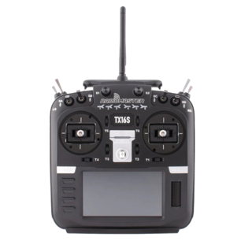

This 16-channel transmitter is included with the Aurelia X4 standard drone therefore it is a low cost solution. This transmitter can be programmed from a PC using OpenTX Companion and is best suited for control over flight. There are 2 UART ports included that can be used for GPS, Bluetooth, and other serial devices, allowing the team to have live GPS updates from the drone as well as support Bluetooth connection for the Single Board Computer.  
* **Pros:** Easy to use, cost-friendly; best option for in-flight control
* **Cons:** Does not support camera and microphone feed. 

#### Mobile Device

Handheld device used to program flight paths, set waypoints, and view live telemetry. Is not suitable for flying the drone; this has to be done through the transmitter.   
* **Pros:** Compact, easily transportable.
* **Cons:** Program to change drone settings is not indented for mobile devices; analyzing sensor data is not ideal through a mobile device

#### PC System

Personal laptop to program flight controls, view live telemetry, and set waypoints. All collected data can be wirelessly transmitted to the laptop and processed.  
* **Pros:** Easy to program, program made to be used on PC interface, Cost-friendly 
* **Cons:** Not compact, Implementation may be more complicated 

#### Control System Solution
The ideal solution is a combination of the PC and transmitter system. The PC will be used to determine flight path, radio settings, and analyzing sensor data. The transmitter will only be used for flying the drone and will not be receiving or transmitting any data from aftermarket components.  

### B. Radar Systems 
The Radar systems that are usable for heart rate monitoring are very limited. The options for types of radar signals are pulse, pulse doppler, Continuous Wave (CW) doppler, and frequency modulated continuous wave (FMCW). For measuring heart rate and respiratory signals, CW waveforms are the best option for the most reliable data.  

#### Infineon Demo BGT60UTR11AIP Radar Sensor

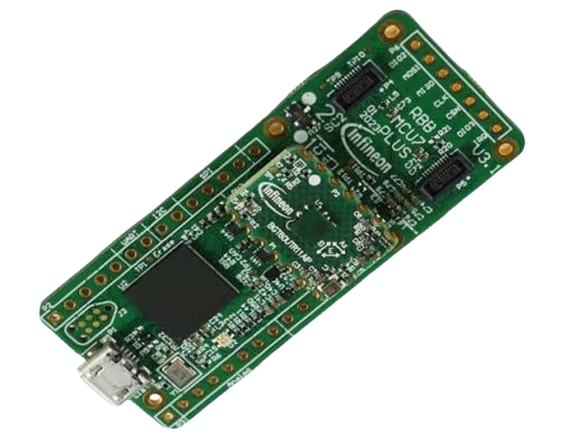

The Infineon Demo BGT60UTR11AIP radar sensor is a 60GHz Frequency Modulated Continuous Wave (FMCW) radar; however, it also possesses the capability to operate in a Continuous Wave (CW) mode. The sensor is attached to an Infineon Radar Baseboard MCU7 Plus which is roughly 3 inches by 1 inch and weighs less than a gram. It can be operated via pins on the board or through a micro-USB connection. Infineon provides an extensive SDK for using this technology as well as a ready-to-go GUI. 
* **Pros:** Uses 60GHz Continuous Waves for reliable readings and has capabilities to use both FMCW and CW doppler waveforms.
* **Cons:** Limited on range and resolution.

#### Texas Instruments AWR1843 Radar Sensor
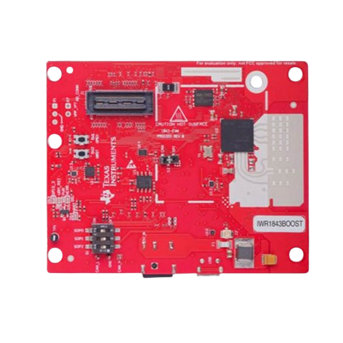

The Texas Instruments AWR1843 radar is an integrated single-chip FMCW radar sensor capable of operation in the 76 to 81GHz band. It is built on TI’s low-power 45nm RFCMOS process, which enables a monolithic implementation of a 3TX, 4RX system with built-in PLL and ADC converters. The device includes a BIST processor subsystem, which is responsible for radio configuration, control, and calibration. 
* **Pros:**  Has a higher frequency range of FMCW waveforms that will penetrate skin less and relay more information. Has built in processing into the board that creates a cleaner signal.
* **Cons:** The radar is the costliest option and requires more power than the other options. 

#### Radar System Solution 
The best of the options is the Infineon Demo BGT60UTR11AIP radar sensor because of its lesser power consumptions, smaller form factor, and more affordable price. The 60GHz range of the radar makes it more than viable for its purpose.  

### C. Human Locating Systems
The location system would help visually locate the victim and establish contact. The Yahboom IMX219 camera, the Waveshare IMX219-83 Stereo Camera, and the Arducam IMX477 HQ Camera are all possible candidates for the location system. 

#### Yahboom IMX219 Camera (Default)

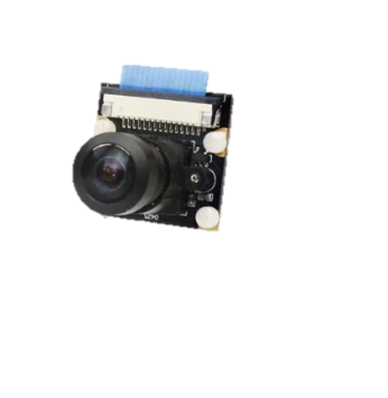

The NVIDIA Jetson IMX219 camera measures 24mm by 25mm. It has a 160° field of view, 800w resolution, a Sony IMX219 chip, and a CSI interface, and is used for real-time image recognition. 
* **Pros:** Compatible with Jetson Nano. Features a 160° field of view. 1080P resolution with 800W pixels. Supports real-time human detection. Connects directly to the Nano via a ribbon cable.
* **Cons:** Image processing may be delayed due to limited computing resources, and wide-angle images can be distorted, reducing detection.  

#### Waveshare IMX219-83 Stereo Camera

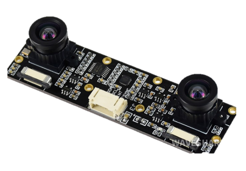

The Waveshare IMX219-83 Stereo Camera uses a dual-camera system to estimate depth and width, helping locate victims. Each camera has a 3280 × 2464 resolution and an 8-megapixel rating. The system features less than 1% lens distortion, a 73-degree field of view, and a 60 mm stereo baseline. It is compatible with the Jetson Nano B01. 
* **Pros:** Compatible with Jetson Nano. Dual cameras can locate and estimate distance more accurately. Has built-in motion sensing. Less than 1% distortion. Has two Sony IMX219 chips.
* **Cons:** Environmental conditions could affect depth accuracy. More image processing is required. Has a smaller field of view of about 73 degrees.

#### Arducam IMX477 HQ Camera

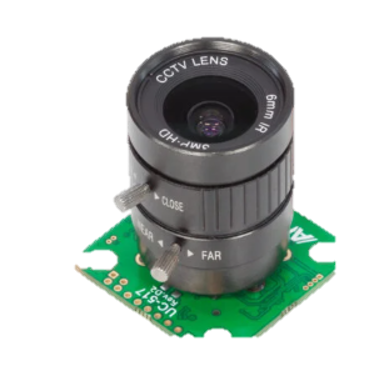

Waveshare IMX219-83 Stereo Camera uses a dual-camera system that can estimate depth and width, which helps locate The Arducam IMX477 HQ Camera is compatible with the Jetson Nano. The camera supports interchangeable lenses and has a field of view of 65 degrees. It has 12.3 megapixels. This camera improves image detail for identifying people in the captured footage. 
* **Pros:** Compatible with Jetson Nano. Higher image resolution. Improves visual tracking and human detection. Interchangeable lenses.
* **Cons:** Does not measure distance. The standard lens has a narrower horizontal field of view, maxing out at 65 degrees. Additional lenses are needed for a wider field of view. The high resolution might increase image-processing demand.  

#### Human Locating System Solution
The sensor chosen for human locating was the Yahboom IMX219 160-degree camera. This device lacks depth perception but offers broader scene coverage and requires less processing power than the other options. Higher processing power increases the likelihood of lag. 

### D. Communication Systems
In the team's design, they implemented two communication systems. One of the communication systems is dedicated to the data transfer between the Single Board Computer and a personal laptop. The second system is dedicated to human communication. To achieve this, the team will implement a speaker and microphone to communicate with the victim.  

#### 1. Data Transfer 
To successfully transmit data from the Jetson Nano to a personal laptop, Allison found solutions in 3 categories. These include Wi-fi/Bluetooth, cellular, ethernet, and long-distance radio communication (LoRa).  

**EDIMAX N150**

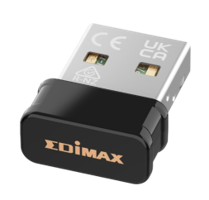

Supports both Wi-Fi and Bluetooth connections that are compatible with the Jetson Nano. It operates with speeds up to 150Mbps. It comes with built-in network security and is compatible with both Windows and Linux. The range for the EDIMAX N150 is 10-30 meters. It is capable of transmitting radar data, camera feed, and microphone data.  
* *Pros:* Jetson Nano compatible, Does not require bulky aftermarket attachments, lightweight
* *Cons:* Short range.

**Intel AC8265 Wireless NIC**

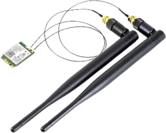

Supports both Wi-fi and Bluetooth connections that are compatible with the Jetson nano. It operates at speeds of 300Mbps at 2.3GHz. The range for the Intel AC8265 Wireless NIC is typically 30-50 meters. It can transmit radar data, camera feed, and microphone data. It also has integrated network security.  
* *Pros:* Jetson Nano compatible, lightweight.
* *Cons:* Short range.

**GNSS Expansion Board Module**

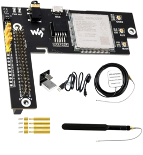

Supports 4G cellular communication and is compatible with the Jetson nano. The range is 5000 meters. Is capable of transmitting video, microphone, and radar data over very long distances. This option is significantly more complicated to integrate with our current system. The component itself will reduce our available payload compared to other options.  
* *Pros:* Long range.
* *Cons:* Difficult to integrate and set up, weight of component

**LoRa (Long Range Radio)**

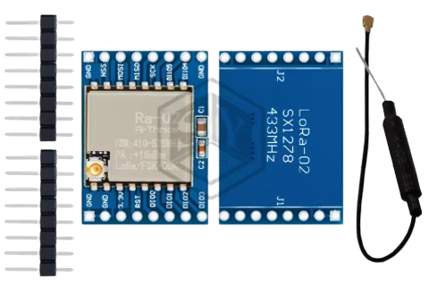

Supports long range radio communication that is suitable for sending images in clusters. This will allow the camera feed to be transmitted over long distances. The range is 300 meters. This gives the longest range with the lowest cost. It can transmit microphone, radar, and video. The video feed would be grey scale and sent in small clusters. 
* *Pros:* Long range, low cost, lightweight.
* *Cons:* Lower quality video, susceptible to external noise interference.

##### Data Transfer System Solution
The ideal solution for data transfer from Jetson nano to a personal laptop is the Intel AC8265 Wireless NIC Wi-fi adapter. This is because it can transmit high-quality video feed along with all other sensor data. In the case of an extremely rural environment, LoRa will also be equipped to transmit low-quality video in the form of image clusters and all other sensor data.  

#### 2. Human Communication
Communication with the victim is a central component of this project. To identify an appropriate solution, five sensors were evaluated: three for capturing audio from the victim, the ReSpeaker 4-mic Array, the ReSpeaker XMOS XVF3800, and the RØDE VideoMic Go II, and two for communicating with the victim: the 2831/3128 mini full-range cavity speaker and the Yahboom USB sound card and speaker for Raspberry Pi/Jetson/RDK series boards. 

**ReSpeaker 4-Mic Array (UAC 1.0 - Default)** 

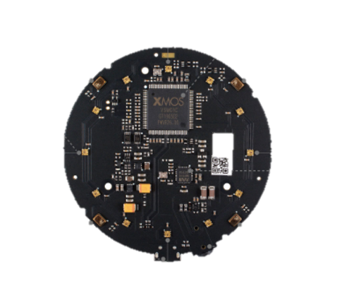

The Seeed Studio ReSpeaker 4-Mic Array is a low-power USB microphone array. It features embedded audio processing, voice capture, sound direction detection, and noise suppression. These capabilities are well suited to communicating with potential victims.   
* *Pros:* Has 4 mics to support audio capture and sound direction. Uses USB, so it is compatible with most computing platforms. Has features to suppress unwanted noise and boost voices. Low power consumption.
* *Cons:* Internal filtering might not be sufficient to reduce drone noise. Speech recognition could be used but would require additional software. A speaker is needed to enable two-way communication.
**ReSpeaker USB 4-Mic Array XVF3800**

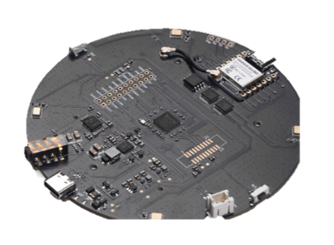

The ReSpeaker XMOS XVF3800 is an updated version of the ReSpeaker 4-Mic Array. It features onboard audio processing, 360-degree voice pickup, echo cancellation, voice activity detection, and noise suppression. 
* *Pros:* It offers 360-degree sound pickup and sound-source localization to help identify a person’s location. It can pick up voices from up to 5 m away and connect via USB or I2S. It also features echo cancellation and noise suppression.  
* *Cons:* It is expensive, does not completely eliminate drone noise, and may not support all features on the Jetson Nano; additional hardware may be required.

**RØDE VideoMic Go II:**
  
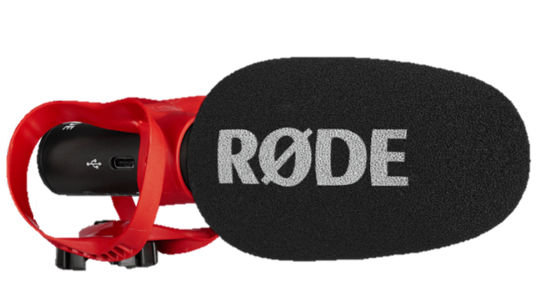
  
The VideoMic Go II is a compact, lightweight directional microphone with USB-C digital and 3.5mm analog outputs. It also offers advanced features, including powerful digital processing and pickup pattern options. 
* *Pros:* The microphone primarily picks up sound from the direction it’s pointed. It is lightweight, includes a windshield, and connects via USB.
* *Cons:* It is expensive. Since it is close to the drone, it may still pick up the drone’s noise. It would also require additional software to run on a Jetson Nano and must be aimed at the victim to capture their voice clearly.
**2831/3128 Mini Full-Range Cavity Speaker**
  
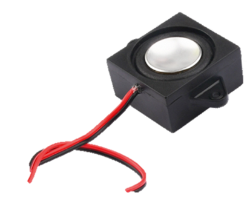

The 2831/3128 mini full-cavity speaker is a compact output speaker designed for tight spaces. 
* *Pros:* It is compact and lightweight, consumes little power, and its full-range design makes it ideal for voice instructions.
* *Cons:* It may not be loud enough to overcome the drone noise and may require an amplifier. Clarity isn’t guaranteed under unfavorable conditions.

**Yahboom USB Sound Card & Speaker**

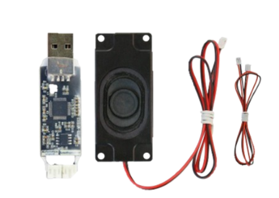

The Yaboom USB sound card and speaker kit is an excellent choice for audio output. It works with the Jetson Nano and Yaboom Camera without additional components and is reasonably priced. 
* *Pros:* Designed for the Jetson Nano, it’s compact, budget-friendly, and requires no additional software or components.
* *Cons:* Few people have tested the product, so its performance is still uncertain. Its dual-system design also contributes to its greater weight.

##### Human Communication System Solution
The ReSpeaker 4-Mic Array was selected as the microphone because it requires considerably less processing power than the updated version, making it better suited to the Jetson Nano. Its features are also sufficient to meet the intended requirements. Although the microphone may not effectively filter out drone noise, it can be programmed to do so. The Yahboom4m USB Speaker appears to be the most compatible option. The Mini Full-Range Speaker has undergone more testing than the Yahboom USB Speaker, making it the more reliable choice. If necessary, two full-range speakers could be used to amplify the speaker’s voice. 

---

## V. High-Level Solution
The Triage Drone integrates a sensing and processing payload onto the Aurelia X4 standard. The X4 Pixhawk flight controller running ArduPilot handles stabilized and semi-autonomous flights. A Jetson Nano serves as the onboard computer controlling the sensors, camera, microphone, and speaker. It runs victim detection and vital sign processing on board so that only live results rather than raw recordings are sent to the command center.

| Subsystem | Selected Solutions | Purpose | Requirements Addressed |
| :--- | :--- | :--- | :--- |
| **Drone Platform** | Aurelia X4 Standard with Pixhawk flight controller and ArduPilot | Carries and powers payload, provides stabilized flight, GPS navigation, and return-to-home. | S5, S6, C1–C4, C7 |
| **Pathfinding & Obstacle Detection** | GPS waypoint navigation via ArduPilot; LiDAR obstacle avoidance | Semi-autonomous flight through predefined search areas, including low visibility. | S5, C7 |
| **Human Detection** | Two IMX219 cameras on Jetson Nano cross-checked with radar | Detects and locates victims | S1, S3 |
| **Vital Sensing** | Infineon BGT60UTR11AIP $60\text{ GHz}$ radar | Non-contact heart and respiration rate tracking in $0.1\text{--}3\text{ Hz}$ band | S2 |
| **Signal Processing & Inferencing** | Onboard processing via Jetson Nano | Filters radar/audio/image data and packages results for transmission | S1–S4, S7 |
| **Human Communication** | ReSpeaker 4-Mic Array v2.0 + Cavity Speaker ($80\text{--}225\text{ Hz}$ filtered) | Two-way audio between victim and command center | S4 |
| **Data Transfer** | Encrypted IEEE 802.11 Wi-Fi link (Intel AC8265) / Backup LoRa | Carries live video, audio, vitals, and GPS to command center | S4, S7, C5 |
| **Control Systems** | Command center PC + Radiomaster TX16S Transmitter | Operator interface for monitoring, flight control, verification, and intervention | C7, S7 |
| **Power & Circuitry** | Shared flight battery or external payload battery with regulated supply | Powers payload electronics without compromising flight duration or signal quality | S6, C6 |
| **Mounts & Arm** | PETG 3D-printed mounts and extendable arm (ME Team) | Holds payload, damps vibration, resists moisture/UV | S1, S2, S5 |

### Maximizing Stakeholder Goal Attainment 
Each customer objective maps directly to a subsystem. Radar-based vital sensing reflects Dr. Blair's expertise in non-contact measurements. Combining camera YOLO detection with radar verification improves detection confidence during visual degradation [16]. Two-way audio allows responders to assess victim consciousness. Onboard processing ensures the command center receives real-time metrics without network latency.

### Adherence to Constraints 
The design stays within FAA Part 107 limits for altitude, speed, weight, and lighting [12][14]. The $3.3\text{ lb}$ payload limit of the X4 is tracked via a strict mass budget. Data transmission utilizes encrypted IEEE 802.11 [18]. System EMI is verified under MIL-STD-461G [19]. Autonomy is capped at SAE J3016 Level 3 equivalence for continuous human oversight [20]. Data is streamed live without onboard persistence, satisfying C8.

### Risk Minimization 
| Risk | Mitigation in Design |
| :--- | :--- |
| **Payload exceeds 3.3 lb limit** | Strict mass budget maintained for every component, mount, wire, and fastener. |
| **Flight time below 15 mins** | Component power budget enforced; Jetson power modes optimized; hover energy budgeted. |
| **Jetson resets during motor current spikes** | Regulated buck supply sized to ride through takeoff/gust transients. |
| **Motor noise corrupts radar/audio** | Shielded power wiring, software FIR notch filtering, and MIL-STD-461G testing. |
| **Camera degraded by smoke/fog** | Radar and LiDAR provide non-visual detection and obstacle avoidance [17]. |
| **Lost link or low battery** | Automatic Return-to-Home (RTH) triggered with safe battery reserve. |
| **False "no vital signs" reading** | Readings displayed with confidence levels; operator verification mandatory. |
| **Unauthorized data access** | Encrypted link, command PC access control, and zero local data storage. |

### Resource Utilization 
Major hardware assets (Aurelia X4, Jetson Nano, ReSpeaker array, LiDAR, GPS) are already owned by the team. The projected purchase cost is $54 for two additional IMX219 cameras and PETG filament. The design builds upon prior capstone iterations [8][9] using COTS modular components for cheap and fast replacement.

---

### A. Hardware Block Diagram
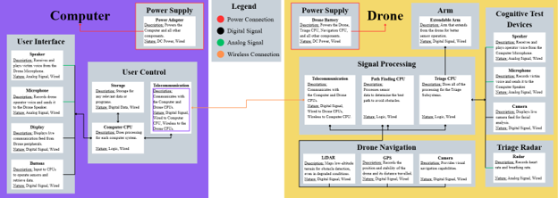

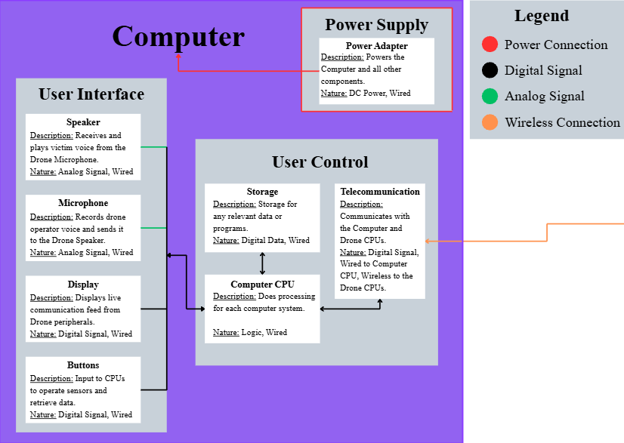

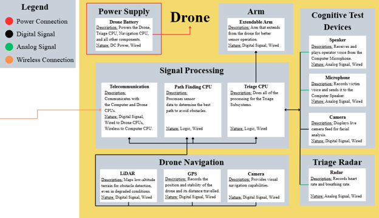

The above hardware block diagrams, created in Canva, center on the drone and the computer. The diagrams visually break down the primary subsystems, focusing on communication paths between the components. Any analog signal is converted to a digital signal, and the power supply for each main system powers that entire system. The controller is omitted from the diagram due to the lack of planned modifications.

### B. Operational Flow Chart
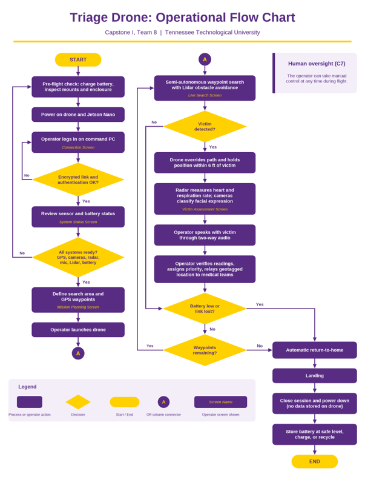

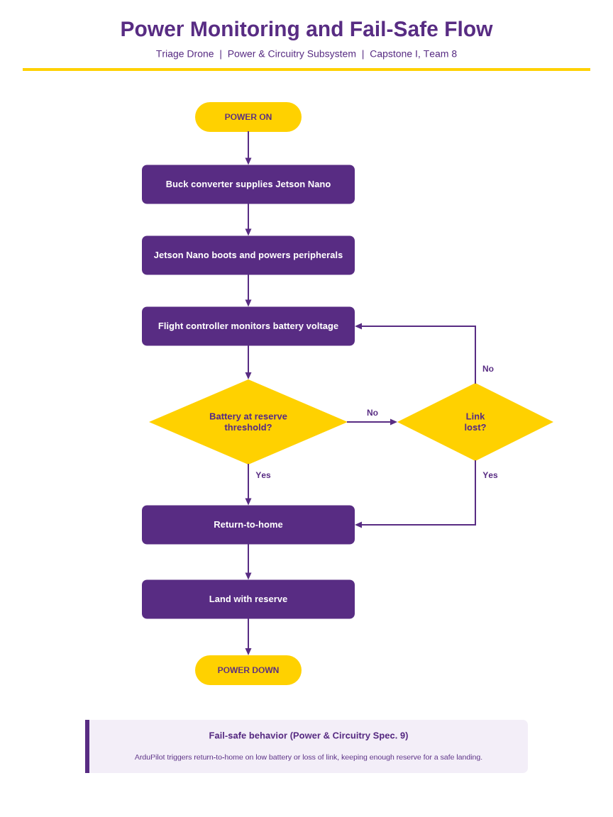

---

## VI. Atomic Subsystem Specifications

### A. Drone Subsystem
**General Overview** 

The Drone Subsystem is responsible for housing, transporting, and providing flight stability for all onboard sensing, computing, and payload components. The system is comprised of an open-source multi-rotor aerial platform, the Aurelia X4 Standard, equipped with a Pixhawk flight controller running Ardupilot to manage flight maneuvers, telemetry, and semi-autonomous navigation. 

**Subsystem Operation** 

This system remains inactive and grounded during pre-flight checks and launch preparations until commanded by the remote pilot. These checks and preparations include plan initialization, GPS verification, battery life verification, and rotor/chassis health verification. Once activated, the flight controller executes semi-autonomous navigation through GPS waypoints to position the drone near or over a target area with a stable hover. The drone supports the entire payload consisting of the SBC, sensor modules, and telescoping arm while managing power consumption to ensure flight duration is not excessively reduced. The platform navigates within visual line of sight and adheres strictly to firmware-enforced operational limits, ensuring safe transit to and from the designated disaster sight before executing a safe landing with adequate battery reserves. 

**Interfacing:**

| Interface | Connected Subsystems | Type | Direction | Protocol/Standard | Description |
| :--- | :--- | :--- | :--- | :--- | :--- |
| Flight Controller  | Integrated Control System  | Embedded Controller | Bidirectional | MAVLink/Internal Bus | Flight controller that coordinates navigation with ground control. |
| Radio Telemetry  | Interfacing (Integrated into Drone) | Wireless Radio Frequency | Bidirectional | Proprietary RF | Transmits flight telemetry to and receives input from ground control. |
| Power Distribution  | Power & Circuitry Design | DC Power | Input | Battery Bus | Drone battery provides power to the drone. |

**Specifications:**

The specifications for the subsystem are as follows: 
1. The drone SHALL remain under 400 ft above ground level per 14 CFR §107.51 [12][14]. 
2. The drone SHALL not exceed a ground speed of 87 knots (100 mph) per 14 CFR §107.51 [12][14]. 
3. The drone SHALL be equipped with anti-collision lighting visible for at least 3 statute miles for night and civil twilight operations per 14 CFR §107.29 [12][14].  
4. The drone SHALL weigh under 55 lbs. at takeoff, including payload and batteries, per 14 CFR §107.3 [12][14].  
5. The drone SHALL remain within the visual line of sight of the remote pilot in command per 14 CFR §107.31 [12]. 
6. The drone SHALL comply with Remote ID requirements per 14 CFR Part 89 [24]. 
7. The drone SHALL meet the requirements for operations over people per 14 CFR Part 107 Subpart D, utilizing propeller guards or ducted fans with no exposed rotating parts that could lacerate human skin [25]. 
8. Flight testing in controlled airspace SHALL obtain FAA airspace authorization per 14 CFR §107.41 [12]. 
9. The drone and its UAS critical components (flight controller, communication and data transmission systems, ground control station, navigation system, batteries, and motors) SHALL not be equipment on the FCC Covered List, unless they were previously FCC-authorized or have been exempted through the Department of War Blue UAS Cleared List or an FCC Conditional Approval [27]. 
10. The fully equipped system SHALL complete a test flight lasting at least the minimum mission duration of 15 minutes with sufficient battery reserve to land safely. 

**Flowchart**

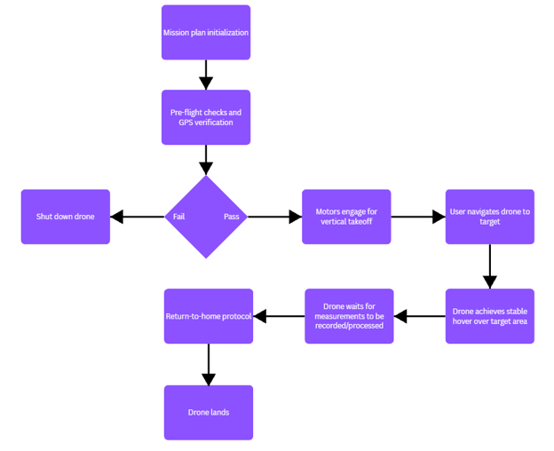

**Applicable Standards** 

This subsystem must comply with federal regulations and industry standards governing unmanned aircraft systems. Federal Aviation Administration (FAA) Part 107 regulates small unmanned aircraft systems, establishing quantitative limits for maximum altitude, ground speed, anti-collision lighting, and visual line of sight operations. Operations over people under 14 CFR Part 107 Subpart D require safety measures such as propeller guards or ducted fans and minimum hover offsets. Compliance with Remote ID requirements under 14 CFR Part 89, ANSI/UL 3030 standards for unmanned aircraft electrical systems, and restrictions against FCC Covered List components ensures overall airworthiness and legal operation. 

---

### B. Power & Circuitry Design Subsystem
**General Overview** 

The Power & Circuitry Design subsystem supplies energy to every payload component added to the Aurelia X4. The X4 can carry up to 3.3 lb of payload [1]. In its default configuration, all payload electronics draw from the same battery that powers the motors, so every added gram and every added watt shortens flight time. The subsystem must deliver clean, stable power to the Jetson Nano and its peripherals so that the fully equipped drone completes the 15-minute minimum mission (S6) with enough reserve to land safely. It must also keep electrical noise from degrading the radar and audio signals. 

Because the payload load directly competes with the motors for energy, the team is evaluating two power architectures: 
* **Configuration A (Shared Flight Battery):** The payload is powered from a protected branch of the X4's flight battery. This is the baseline design.
* **Configuration B (External Payload Battery):** A separate, dedicated battery mounted on the airframe powers the Jetson Nano and its peripherals. The X4's flight battery then powers only the flight controller, motors, and flight-critical sensors.
The final selection will be made after the power and mass budgets are completed and verified by bench measurement. The subsystem is designed so that either configuration can be adopted without changing the downstream regulation, peripheral power, or noise-control design.

**Power Architecture Options** 

**Configuration A: Shared Flight Battery**

A dedicated payload branch is taken from the X4's power distribution, protected against overcurrent, and stepped down by a synchronous buck converter such as the Texas Instruments TPS56637 [7] to the input required by the reComputer J1020 v2 [5]. 
* *Advantages*: No additional battery mass. A single battery to charge, monitor, and manage. The flight controller's existing low-battery fail-safe covers the entire system.
* *Disadvantages*: Every watt drawn by the payload reduces flight time. Voltage sag during take-off and wind gusts reaches the payload regulator directly, which increases the risk of Jetson Nano resets. Motor and ESC noise share a common supply with the radar and audio electronics.

**Configuration B: Shared Flight Battery**

A separate battery, sized from the payload power budget, feeds the same protection and regulation stage. The payload and flight systems share only a common ground reference, which the serial data link between the Jetson Nano and the flight controller requires. 
* *Advantages*: The payload no longer draws from the flight battery, so it no longer reduces the motors' energy reserve. The payload supply is isolated from motor-induced voltage sag, removing the main cause of Jetson Nano resets. Motor and converter noise is less likely to couple into the radar and audio subsystems. The payload battery can be swapped or charged independently.
* *Disadvantages*: The added battery mass counts against the 3.3 pound payload limit [1] and increases the power the motors need to hover, which partly offsets the energy saved. The system now has two batteries to charge, store, and monitor. The flight controller's fail-safe no longer sees the payload battery, so a separate monitoring and shutdown path is required. Mounting space and moisture protection for a second battery must be coordinated with the Mechanical Engineering team.

**Interfacing:**

| Interface | Connected Subsystems | Type | Direction | Protocol/Standard | Description |
| :--- | :--- | :--- | :--- | :--- | :--- |
| Drone  | Drone | DC Power | Output | Battery Bus | Provides Power to the Drone. |
| Single Board Computer | Signal Processing  | DC Power | Output | Battery Bus | Provides Power to the SBC. |
| Sensor Suite  | Interfacing, Human Detection, Vital Sensing, Human Communication | DC Power | Output | Battery Bus | Provides power to the Data Transfer System, Speaker, Cameras, Radar, and Microphone. |
| Arm | N/A | DC Power | Output | Battery Bus | Provides power to the telescoping arm's motors. |

**Specifications:**
The specifications for the subsystem are as follows: 
1. The power and circuitry subsystem SHALL include low-battery triggers and protocols. 
2. Onboard electronics SHALL meet the unintentional radiator emission limits of 47 CFR part 15 Subpart B [26]. 
3. The EMI test setup SHALL maintain all measurement tolerances within the limits specified by MIL-STD-461G § 4.3.1 [19]. 
4. Lithium batteries SHALL comply with the IEC 62133-2 or UL 2054 safety requirements [27] and SHALL meet UN 38.3 if shipped [40]. 
5. The drone's electrical system SHALL be designed following ANSI/UL 3030 for unmanned aircraft systems [38]. 
6. The system’s moisture protection SHALL be rated and tested per IEC 60529 [22].
7. The drone and its UAS critical components (flight controller, communication and data transmission systems, ground control station, navigation system, batteries, and motors) SHALL not be equipment on the FCC Covered List, unless they were previously FCC-authorized or have been exempted through the Department of War Blue UAS Cleared List or an FCC Conditional Approval [27]. 
8. The fully equipped system SHALL complete a test flight lasting at least the minimum mission duration of 15 minutes with sufficient battery reserve to land safely. 
9. The system SHALL satisfy payload capacity and power distribution limits of the platform defined by the Aurelia X4 User Manual [1]. 

**Flowchart**

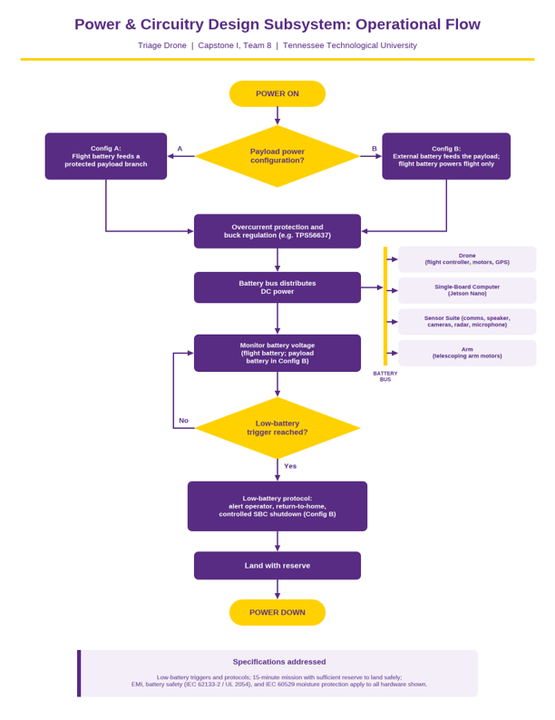

**Applicable Standards** 

This subsystem must comply with electrical, environmental, and federal standards governing unmanned aircraft power distribution. Federal Aviation Administration (FAA) Part 107 regulations govern aircraft airworthiness, ensuring total takeoff weight limits are maintained and under 55 pounds [12][14]. The electrical architecture is designed in accordance with ANSI/UL 3030 standards for unmanned aircraft electrical systems, alongside IEC 62133-2, UL 2054, and UN 38.3 requirements to ensure lithium battery safety and secure transport [27][38][40]. Environmental resilience and moisture protection are verified per IEC 60529, while electromagnetic compatibility and power wiring tolerances are governed by MIL-STD-461G § 4.3 to prevent electrical noise from disrupting adjacent radar and audio subsystems [19][22][26]. Furthermore, adherence to FCC Part 15 Subpart B unintentional radiator limits, restrictions against FCC Covered List components, and professional obligations under the NSPE and IEEE Codes of Ethics ensure safe, reliable, and legally compliant power management during all flight operations [24]-[27].

---

### C. Signal Processing Subsystem
**General Overview** 

The signal processing subsystem is the main pipeline for obtaining readable and reliable data from the vitals subsystem and the human detection subsystem. This subsystem is internal to the single board computer, which will receive all sensor data from the sensors and process into usable data, prepared for being transmitted to the control center. The signal processing will be completed by means of digital processing techniques.  

**Subsystem Operation **

The signal processing subsystem will receive three separate inputs: the radar, microphone, and camera. The radar and microphone signals are the priority for the signal processing subsystem. For the radar signal, the subsystem will apply a finite impulse response (FIR) low-pass filter that will cut off any unwanted frequencies greater than 5 Hz; all the desired vital readings will occur below this frequency range [36]. After filtering, the signal will then be down sampled to 10-20 Hz to reduce computational load while retaining all relevant physiological information [37]. To acquire the heart rate sensor, a FIR band-pass filter will be applied that allows frequencies between 0.8-3.0 Hz. A similar filter will be applied to the respiratory signal with the allowed frequencies being between 0.13-1.0 Hz [37].  

For the microphone signal, the predominant noise that will interrupt communications is the operational frequency of the drone. This frequency is dependent on the RPM output of the rotors; therefore, the signal processing subsystem will take the Fast Fourier Transform (FFT) of the signal to identify frequency peaks associated with the propellers. With this calculation, ranges for a FIR notch filter can be found and applied to the signal. This will decrease the interference of the drone’s operational frequency from the desired audio signal.  

**Interfacing:**

| Interface | Connected Subsystems | Type | Direction | Protocol/Standard | Description |
| :--- | :--- | :--- | :--- | :--- | :--- |
| CW Doppler Radar | Vital Sensing | Serial | Input | USB | Collects heart rate and respiratory data and sends it to the SBC. |
| Microphone | Human Communication | Serial | Input | I2S/USB | Collects audio signals and sends them to the SBC. |
| Speaker | Human Communication | Analog | Output | I2S/USB | SBC sends audio data to the speaker module for audible output. |
| Camera | Human Detection | Serial | Input | MIPI CSI-2 | Collects video and sends it to the SBC. |
Power | Power & Circuitry Design | DC Power | Input | Battery Bus | Drone battery provides power to the SBC. |

**Specifications:**
The specifications for the subsystem are as follows: 
1. The signal processing subsystem SHALL use digital signal processing techniques [36].
   a. to determine respiratory rate (range 0.13 to 1.0 Hz)
   b. heart rate (range 0.8 to 3.0 Hz). 
3. DSP SHALL complete within 500ms per update cycle [37]. 
4. The subsystem SHALL operate using data samples at 100-200Hz [37]. 
5. The subsystem SHALL perform all DSP steps locally aboard the Aurelia X4 drone [13]. 

**Flowchart**

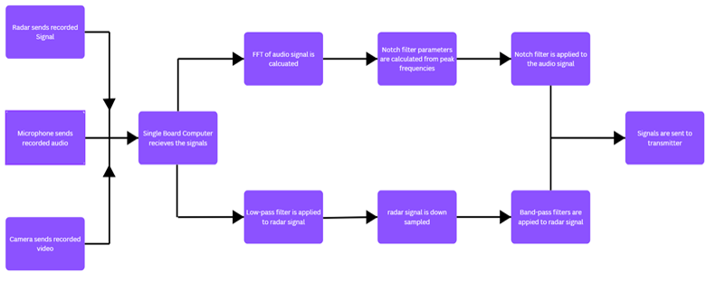

**Applicable Standards** 

The main applicable standard that applies to the digital processing subsystem is HIPAA. The privacy laws state that during no point of the data acquisition and processing can the health data be stored and/or associated with the individual being recorded with proper consent and license [26]. 

---

### D. Interfacing Subsystem
**General Overview** 

The interfacing subsystem shows the relationship between the mechanical arm, sensors, wireless data transfer, and PC system. This routes all data gathered by the radar, camera, and microphone to the Jetson nano where it is wirelessly transmitted to the PC. The interfacing process is completed through a combination of hardwire and wireless connections. 

**Subsystem Operation **

The interfacing subsystem details the relationship between each component used in the team's design. The radar, cameras, and microphone transmit data to the Jetson nano, while the mechanical arm is controlled by it. The collected data is then processed locally on the Jetson nano. Before transmitting the collected data, the Jetson nano checks for a Wi-fi connection. If there is no connection found, it will wait and recheck every 5 seconds. In the case of a rural condition where Wi-fi is not available, the same process will happen with the LoRa. Once there is a connection found, the processed data is transmitted to the remote PC control system. The telemetry data is then displayed on the screen. The PC control system is also responsible for programming the drone controls before flight. This system is powered by the drone's battery or external power supply detailed in the power and circuity design subsystem. 

**Interfacing:**

| Interface | Connected Subsystems | Type | Direction | Protocol/Standard | Description |
| Single Board Computer (SBC) | Signal Processing | Serial | Input | USB | Maintains a processed data stream between the SBC and wireless transmitter. |
| Power | Power & Circuitry Design | DC Power | Input | Battery Bus | Drone battery provides power to the telemetry system. |
| Wireless Communication | Data Transfer | DC Power | Bidirectional | NGFF (M.2) | Maintains data stream between SBC and PC. |
| PC | Control System | AC Power | Bidirectional | IEEE 802.11ac | Used to program flight controls and view live telemetry. |

**Specifications:**
The specifications for the subsystem are as follows: 
1. This subsystem SHALL display data from signal processing subsystem on a laptop screen.
2. This subsystem SHALL use the wireless communication of the drone and aftermarket Wi-fi adapter.
3. This subsystem SHALL run a program on a personal laptop to connect to the drone.
4. This subsystem SHALL display triage results and vitals wirelessly.  

**Flowchart**

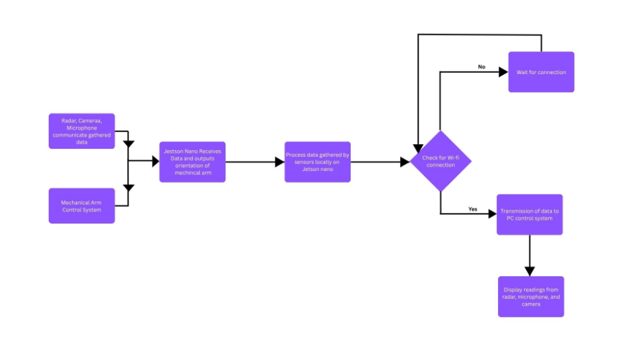

**Applicable Standards** 

This subsystem must comply with the IEEE, ISO, and HIPPA standards. IEEE 802.11ac defines the frequency band that the team can be operating in. This allows the Jetson nano to be able to communicate and transmit data within the range of 5GHz [C5]. ISO 14971 manages the risk of wireless communication errors. Choosing the incorrect frequency or bandwidth can interfere with communication between first responders and other government operations. HIPPA states that no data can be stored locally detailing any person's medical information attached to it. This is integrated into the team's design through erasing the data collected after each mission.  

---

### E. Human Detection Subsystem
**General Overview** 

The Human Detection subsystem identifies disaster victims using image-processing techniques. Its primary purpose is to help first responders assess hazardous situations while maintaining situational awareness. The system uses a Yahboom IMX219 camera featuring a 160-degree field of view, image-processing capabilities, and 1080p resolution. It is also compatible with the Jetson Nano, where it will be integrated to detect human movement and facial expressions.   

**Subsystem Operation **

The human detection subsystem will use the Yahboom IMX219 camera to capture video and transmit it to the Jetson Nano for processing. Once processed, the images will be sent to emergency personnel to assess the situation. The system will remain operational while searching the scene for human forms. Once a person is detected, the camera will assist with communication with the victim. 

**Interfacing:**

| Interface | Connected Subsystems | Type | Direction | Protocol/Standard | Description |
| Single Board Computer (SBC) | Signal Processing | Serial | Output | MIPI CSI-2 | Receives data from the cameras and processes all the data to be transmitted to the control center. |
| Power | Power & Circuitry Design | DC Power | Input | Battery Bus | Drone battery provides power to the cameras. |

**Specifications:**
The specifications for the subsystem are as follows: 
1. The system SHALL detect human figures. 
2. The system SHALL detect facial expressions. 
3. The system SHALL remain clear under the specified environmental conditions. 
4. The system SHALL provide continuous access during flight.
5. The system SHALL operate within the allocated payload weight and electrical power budgets. 

**Flowchart**

**Applicable Standards** 

The Human Detection subsystem must comply with several requirements to operate safely. One applicable standard is the HHS HIPAA standard, which requires that the drone not store the victim’s data. Another is IEEE 802.11, which requires a secure wireless connection between the subsystem and the control center. Under FAA 14 CFR Part 107, the drone’s integrity must not be compromised. This means that any equipment added to the drone must be properly integrated. The NSPE and IEEE codes of ethics state that the subsystem should adhere to safe practices, including sound design, reliability, and responsible conduct. Every component should be tested honestly before and after it is integrated into the subsystem.

---

### F. Vital Sensing Subsystem
**General Overview** 

The Vital Sensing Subsystem is responsible for collecting and processing vital sign data. This system is comprised of a digital signal processing pipeline that extracts heart and respiratory rates from CW Doppler radar data without contact. 

**Subsystem Operation **

This subsystem will remain off until the drone has come to a standstill and the user has activated the system. Once the vital systems is turned on, the heart and respiratory data is gathered based on the propagation delays of the continuous radar wave and the quasi-periodic vibrations, resulting from respiration and heartbeat, modulate such waves. The doppler radar sends continuous millimeter-waves (mm-waves), that being waves whose central frequency falls between 30 GHz and 300 GHz, to the desired target where displacements in the human body, due to heartbeats and respiration, are measured and recorded [28]. The subsystem will plot the propagation delays of the across time to create the ECG and respiratory readings. The subsystem will connect the data to the Single Board Computer to be processed and transmitted to the control center. Once the desired data is obtained, the user will deactivate this subsystem.  

**Interfacing:**

| Interface | Connected Subsystems | Type | Direction | Protocol/Standard | Description |
| Single Board Computer (SBC) | Signal Processing | Embedded Controller | Output | USB | Receives data from the Doppler Radar and processes all the data to be transmitted to the control center.  |
| Power | Power & Circuitry Design | DC Power | Input | Battery Bus | Drone battery provides power to the doppler radar. |

**Specifications:**
The specifications for the subsystem are as follows: 
1. The subsystem SHALL be operational from a distance of at least one meter.
2. The subsystem SHALL not pose any threat to its subject.
3. The subsystem SHALL obtain the presence of a heartbeat and its frequency (range 0.45 to 3.33Hz).
4. The subsystem SHALL obtain the breathing rate and frequency (range 0.1 to 1 Hz).
5. The subsystem SHALL communicate with the single board computer for signal processing and data transmission. 

**Flowchart**

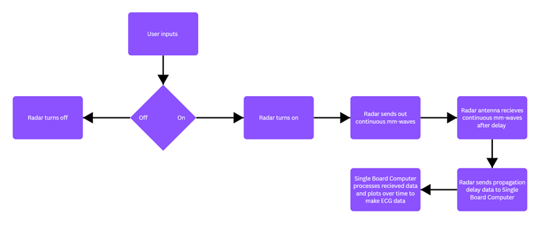

**Applicable Standards** 

This subsystem will have to abide by the standards of multiple governing bodies. One such standard is the FDA Cardiac Monitor Guidance. This standard outlines validation and testing frameworks for Class II cardiac devices [32]. Another cardiac device-based standard is ANSI/AAMI EC13, which traditionally governs cardiac monitors, cardiotachometers, and heart rate alarms for contact ECG devices, but researchers and manufacturers frequently reference its accuracy thresholds (such as maintaining error rates under ± 10 bpm or within 10% for heart rate meters) when validating radar algorithms against a reference ECG [33]. The radar sensor will be emitting radio frequencies towards human bodies; therefore, the radar must comply with IEEE standards for human exposure to electromagnetic fields [34]. FCC chapter 15 governs the bandwidth and peak Effective Isotropic Radiated Power (EIRP) to ensure the radar doesn't cause harmful interference with adjacent telecommunications or automotive radar systems operating in the same bands [35]. 

---

### G. Human Communication Subsystem
**General Overview** 

The Human Communication Subsystem enables the triage drone to communicate with disaster victims. Its primary purpose is to facilitate two-way communication using a microphone and speaker. This capability allows responders to send verbal messages to victims and receive their responses, helping them assess the situation more effectively. The ReSpeaker 4-Mic Array microphone and Mini Full-Range Cavity Speaker were selected for this purpose. The speaker will relay messages to victims, while the microphone will capture their responses. Potential challenges include environmental conditions that may obstruct or interfere with communication. Noise generated by the drone itself may also affect the microphone and speaker. This subsystem is intended to facilitate communication with victims; it does not provide medical assistance.   

**Subsystem Operation **

The Jetson Nano generates a voice prompt or message and transmits it to the sensors in the communication subsystem. The audio is first relayed to the Mini Full-Range Cavity Speaker. After the message is broadcast to the victim, the ReSpeaker 4-Mic Array waits for a response. The recorded audio is then transmitted to the Jetson Nano for processing. Once processing is complete, the response is relayed to the control center to support search-and-rescue operations.  

**Interfacing:**

| Interface | Connected Subsystems | Type | Direction | Protocol/Standard | Description |
| Microphone | Signal Processing | Analog | Input | I2S/USB | Captures real-time vocal responses from victim during cognitive assessment and sends to SBC. |
| Speaker | Signal Processing | Analog | Output | I2S/USB | Receives trigger signals from the SBC to broadcast vocal commands to assess victim's cognitive ability. |
| Single Board Computer | Signal Processing | Serial | Bidirectional | USB | Processes, receives, and transmits acoustic data. |
| Power Distribution | Power & Circuitry Design | DC Power | Input | Battery Bus | Drone battery provides power to the microphone and speaker. |

**Specifications:**
The specifications for the subsystem are as follows: 
1. The system SHALL establish two-way communication between the victim and the control center.
2. The system SHALL be tested for noise distortion during flight.
3. The system SHALL capture audio for the control center.
4. The system SHALL receive audio from the control center. 

**Flowchart**

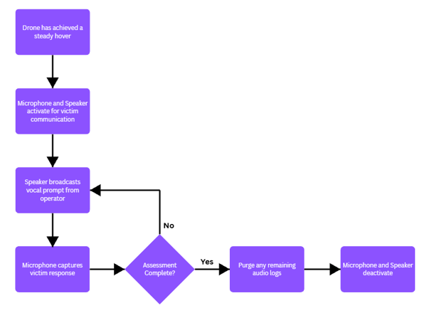

**Applicable Standards** 

The Human Communication subsystem must comply with the following standards. FAA regulation 14 CFR Part 107 requires the drone and its added components to be properly integrated, with no exposed wiring. The wireless link between the communication systems must be properly protected and secured in accordance with the IEEE 802.11 standards. In accordance with HHS and HIPAA requirements, no audio or victim information may be recorded. The NSPE Code of Ethics must also be followed, including requirements to report testing results honestly and adhere to safe engineering practices. 

---

## VII. Ethical, Professional, and Standards Considerations

The Triage Drone is intended to reduce risk to human responders in places where access is limited or dangerous. Placing such technology between victims and their rescuers creates its own responsibilities, however. This section evaluates the project's broader impacts on public safety, public health, society and culture, the environment, and the economy. It also identifies the standards of organizations that inform the design and explains how each consideration has shaped the constraints, specifications, and practices of the project.  

### Public Safety
A malfunction during a rescue mission could delay aid and endanger both victims and responders. A crash could also injure people on the ground or destroy the drone's electronics. The design addresses these risks in several ways: 
* Fail-safes: A low-battery and lost-link return-to-home function, with a battery reserve for landing, is built into the design and is tested rather than assumed to work (Power & Circuitry Specification 9).
* Protected enclosure: PETG mounts and enclosures protect the components and battery during a crash and keep electronics dry (S5) [15].
* Defined operating limits: Limits for wind, rain, and temperature will be documented, so the drone is not deployed outside conditions it has been tested in (S5).
* Electrical safety: Power and wiring systems include protection against shorts and overheating (Power & Circuitry Specification 8) 

### Public Health and Privacy
The drone collects health data, video, and audio of people attheir most vulnerable. Footage recorded along a flight path could also capture unrelated activity, including potential criminal activity, which raises concerns about how such footage might be used by legal authorities [21][22]. These concerns directly shaped the design: 
* The Jetson Nano processes data on board and sends only live results to the command PC. No footage or health data is saved on the drone (C8).
* The data link uses encrypted IEEE 802.11 communication [18], and the command PC uses access control (C5, S7).
* Personal identifiers, such as names spoken over the audio link, are kept separate from vital-sign readings in all displays and logs (C8).
* The drone collects only the data needed for triage and is used only for rescue, never for general surveillance.
* Testing will verify that unauthorized users cannot access the data (S7). 

### Society and Culture
* **Human–drone trust.** Responders who distrust the drone may ignore useful data, while responders who trust it too much may act on incorrect readings. With a target accuracy of roughly 80%, a false "no vital signs" reading could lead to a living victim being overlooked. For this reason, the design keeps a human in the loop at all times (C7) and displays readings with confidence levels so operators can judge how much weight to give them. The drone presents information to responders and does not make final triage decisions.
* **Fairness.** Facial expression classification accuracy can vary with lighting, skin tone, age, and injuries. The team will test detection across different people and conditions and openly report any limitations it finds (S3).
* **Workforce impact.** There is a concern that agencies could use drones to justify reducing human staff. All project documents presented drone as a tool that extends responders' capabilities, not as a replacement for them.
* **Global use and misuse.** Technology that locates people and reads their vital signs could be repurposed for surveillance or military targeting. The team cannot fully control how its work is used later, but its design choices can make misuse harder. Not storing data and not linking health readings to identities are permanent features of the design, not optional settings. Globally, a low-cost triage drone could benefit regions where disasters are frequent and rescue resources are limited. Deployment in other countries, however, carries additional responsibilities, including respecting local airspace laws, cultural norms, and community consent. Ethical guidance for drones is often general rather than drone-specific, and practices vary between settings, so no single set of rules can be assumed to apply everywhere [21][23]. Humanitarian drone use is accepted best when local communities are informed and involved [21]. Accordingly, the drone's intended purpose is stated clearly in all project documents, and any deployment outside a test setting should involve local responders and communities. 

### Environment
LiPo batteries contain materials that harm the environment if sent to landfills and can start fires if disposed of improperly. Damaged drones add electronic waste, a low-flying drone can disturb wildlife, and a crash can leave debris behind. On the positive side, a battery-powered drone produces far fewer emissions than a helicopter or ground-vehicle search. The team will store, charge, and recycle LiPo batteries properly, including discharging them to a safe storage level (Power & Circuitry Specification 10). The modular design allows individual parts to be replaced instead of discarding the whole drone, and crashed hardware and debris will be recovered whenever it is safe to do so. 

### Economy
The Triage Drone could lower the cost of search and rescue. Helicopter searches are expensive to operate, while a drone costs far less to buy, run, and maintain. Finding and prioritizing victims faster also saves search hours and can improve survival outcomes. On the other hand, smaller, rural, or volunteer departments may not be able to afford the system, and ongoing costs such as replacement batteries, crash repairs, and software updates are easy to underestimate. To keep costs low, the design uses commercial off-the-shelf parts and a modular structure that allows damaged components to be replaced cheaply. The team will also document the design thoroughly so that other teams and agencies can build on it. 

### Standards and Regulatory Organizations
| Organization | Requirement | Influence on the Design |
| :--- | :--- | :--- |
| FAA, 14 CFR Part 107 [12][14] | Under 400 ft AGL, under 100 mph, under 55 lb, anti-collision lighting for night operations | Constraints C1–C4; all test flights follow Part 107 |
| IEEE 802.11 [18] | Wireless LAN communication | Encrypted Wi-Fi data link (C5) |
| U.S. DoD, MIL-STD-461G § 4.3 [19] | EMI measurement tolerances | Shielded power wiring and EMI test setup (C6) |
| SAE J3016 [20] | Levels of automation | Autonomy capped at Level 3 equivalence with continuous human oversight (C7) |
| HHS, HIPAA | Protection of health information | No stored health data; identifiers separated from vitals (C8) |
| NSPE Code of Ethics [24], IEEE Code of Ethics [25] | Hold public safety, health, and welfare paramount | Honest reporting, thorough testing, and safe design practices |

Drone regulation is still developing. Search and rescue often requires flying beyond visual line of sight, at night, or over people, which normally requires an FAA waiver or authorization. Public safety agencies can operate under their own certificates and can request expedited emergency approval from the FAA. State laws add further rules, particularly regarding surveillance and how law enforcement may use drone data, and these vary from state to state. In response, the team will design to the strictest applicable requirements, follow FAA rules for all flights, plan for real-world deployment only through an agency that already holds the needed authorization, and monitor rule changes as the FAA develops new rules for beyond-visual-line-of-sight operations. 

### Professional Responsibilities
The NSPE and IEEE Codes of Ethics require engineers to hold public safety, health, and welfare above all else [24][25]. For this project, that means being honest about the drone's limits, testing it thoroughly, and never overstating its accuracy. Each team member carries the following responsibilities: 
* Honesty: Report true sensor accuracy, flight time, and range, and document failed tests and unmet specifications openly.
* Safe design: Build power and wiring systems that protect against shorts and overheating, and test fail-safes instead of assuming they work.
* Privacy: Store no health data, link no data to individuals, secure all data links, and respect anyone recorded during testing.
* Fairness: Test detection across different people and conditions and report any limitations.
* Compliance: Follow FAA rules, campus policies, and the standards listed in the constraints.
* Competence: Work within the team's skills. Mechanical design belongs to the ME team, and the electrical team provides clear electrical requirements.
* Speaking up: Raise safety and ethical concerns, refuse to approve unsafe work, and design against misuse of the drone. 

### Summary of Design Impacts
| **Consideration** | **Design Response** | **Related Requirement** | 
| Public safety | Return-to-home fail-safe, protected enclosure, defined operating limits, electrical protection | S5, S6, C1–C4 |
| Privacy and public health | Onboard processing, no stored data, encrypted link, access control, separated identifiers | S7, C5, C8 |
| Human–drone trust | Human in the loop, confidence levels on readings | C7, S2, S3 |
| Fairness | Testing across people and conditions, with reported limitations | S1, S3 |
| Misuse | Privacy features fixed in the design; stated rescue-only purpose | C8 |
| Environment | LiPo handling and recycling, repairable modular design, debris recovery | Power & Circuitry Spec. 14 | 
| Economy | COTS parts, modular replacement, documented design | Budget 

---

## VIII. Resources

### A. Budget

#### Radar & Data Communication Subsystem
| Item | Cost | Quantity | Subtotal |
| :--- | :--- | :--- | :--- |
| 433MHz SX1278 LoRa Module | $4.47 | 3 | $13.41 |
| Intel AC8265 Wireless NIC | $26.87 | 2 | $53.74 |
| Infineon Demo BGT60UTR11AIP | $156.86 | 1 | $156.86 |
| **Total Cost** | | | **$224.01** |

The LoRa will be used as a data transmission when in rural environments where Wi-fi is unavailable. The main wireless communication will be Wi-fi because of its ability to transmit high resolution live video. The Infineon Demo will be used as our radar due to its small power consumption and small weight. It is necessary to purchase multiple LoRa and AC8265 sensors in the event one of them malfunctions.  

#### Human Communication & Vision Subsystem
| Item | Cost | Quantity | Subtotal |
| :--- | :--- | :--- | :--- |
| Yahboom IMX219 Camera | $26.99 | 2 | $53.98 |
| **Total Cost** | | | **$53.98** |

The Yahboom IMX219 was chosen because of its broad scene coverage and lower processing power required to get good quality video. This camera is also capable of capturing high resolution video and is compatible with the Jetson nano. One camera is needed to see what is in front of the drone for navigation purposes. The second camera will be pointing below the drone to perform triage.  

#### Power Subsystem
| Item | Cost | Quantity | Subtotal |
| :--- | :--- | :--- | :--- |
| 5V External Power Supply | $37.99 | 1 | $37.99 |
| AA Batteries (20 pack) | $9.99 | 1 | $9.99 |
| **Subtotal** | | | **$47.98** |

This 5V external power supply was chosen because it is compatible with the Jetson nano and provides continuous voltage. This eliminates the need for a voltage regulator because our radar, camera, and microphone are no longer connected to the drone's internal battery.   

#### Complete Project Budget
| Item | Cost | Quantity | Subtotal |
| :--- | :--- | :--- | :--- |
| 433MHz SX1278 LoRa Module | $4.47 | 3 | $13.41 |
| Intel AC8265 Wireless NIC | $26.87 | 2 | $53.74 |
| Infineon Demo BGT60UTR11AIP | $156.86 | 1 | $156.86 |
| Yahboom IMX219 Camera | $26.99 | 2 | $53.98 |
| 5V External Power Supply | $37.99 | 1 | $37.99 |
| AA Batteries (20 pack) | $9.99 | 1 | $9.99 |
| Total Cost | | | $325.97 |

---

### B. Division of Labor
The team is composed of five electrical engineering students: Allison Wolden, Ryan Lee, Brandon Price, Weston LaRue, and Sidney Delgado. Each of the team members has a unique technical background and experience that will ensure the success of the project.  

**Allison Wolden**

Skills include coding (C++ and C), embedded systems, wiring, soldering, and technical documentation. She will be responsible for overseeing the wireless communication system because of her experience with embedded systems. She will be working with Weston on the radar and communications sub team.  

**Ryan Lee** 

Skills include circuit design, software programming, microcomputer systems, power management, and data acquisition. He will be responsible for the circuitry design subsystem because of his experience with circuit design and software programming. He will be working with Brandon on the power and circuitry sub team.   

**Brandon Price** 

Skills include power management, power distribution, budget management, and coding (C++). He will be responsible for power management because of his background in power management and distribution.  He will be working with Ryan on the power and circuitry sub team.  

**Weston LaRue**

Skills include digital signal processing, microcontroller programming, software coding, network communications, audio processing, and circuit design. He will be responsible for implementing heart rate and respiratory rate monitoring because of his background in signal processing and microcontroller programming. He will be working with Allison on the radar and communications sub team.  

**Sidney Delgado**

Skills include programming, data analysis, and robotics. She will be responsible for implementing the human communication system because of her background in programming and robotics.  

If new subsystems develop or a team members' expertise is better aligned with another area, the roles may be reassigned. They will only be reassigned with the whole team's consensus or mentor's advisements.  

---

### C. Timeline
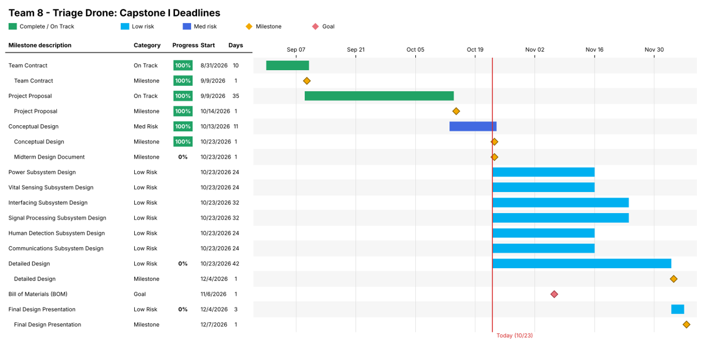

---

## IX. References
[1] Aurelia Aerospace, Aurelia X4 User Manual, Rev. 5, 2026. 

[2] Infineon Technologies, BGT60UTR11AIP 60 GHz Radar Sensor, product page. https://www.infineon.com/cms/en/product/sensor/radar-sensors/radar-sensors-for-iot/60ghz-radar/bgt60utr11aip/  

[3] Infineon Technologies, BGT60UTR11AIP Datasheet. https://www.infineon.com/assets/row/public/documents/24/49/infineon-bgt60utr11aip-datasheet-en.pdf  
[4] Infineon Developer Community, FAQs for XENSIV BGT60UTR11AIP Radar Sensor, 2026. https://community.infineon.com/t5/Knowledge-Base-Articles/FAQs-for-XENSIV-BGT60UTR11AIP-radar-sensor/ta-p/1017137 

[5] Seeed Studio, reComputer J1020 v2 (Jetson Nano) product listing.  

[6] NVIDIA, Jetson Nano power modes (5 W and 10 W). 

[7] Texas Instruments, TPS56637 Synchronous Buck Converter Datasheet. 

[8] Fall 2025 Capstone Team 8, project documents (Power and Safety, Sensors, Communication, Drone Operator, Drone to PC Link). 

[9] Fall 2024 Capstone Team 5, project repository and parts list. 

[10] Customer meeting notes with Dr. Blair, September 16, 2026. 

[11] Power and Payload Design, Aurelia X4 Triage Drone, Fall 2026, September 20, 2026. 

[12] Federal Aviation Administration. (n.d.). Small Unmanned Aircraft System (sUAS). 

[13] “W. Dale Blair | IEEE AESS,” Ieee-aess.org, Sept. 10, 2026. https://ieee-aess.org/contact/w-dale-blair (accessed Oct. 02, 2026). 

[14] Electronic Code of Federal Regulations, "14 CFR §107.51 Operating limitations for small unmanned aircraft." Available: eCFR. 

[15] MatterHackers, “MatterHackers,” MatterHackers, 2026. https://www.matterhackers.com/articles/the-best-3d-printing-filament-for-outdoor-use (accessed Oct. 03, 2026). 

[16] F. Ciccone and A. Ceruti, “Real-Time Search and Rescue with Drones: A Deep Learning Approach for Small-Object Detection Based on YOLO,” Drones, vol. 9, no. 8, pp. 514–514, July 2025, doi: 10.3390/drones9080514 (accessed Oct. 8, 2026) 

[17] P. Tang, J. Li, and H. Sun, “A Review of Electric UAV Visual Detection and Navigation Technologies for Emergency Rescue Missions,” Sustainability, vol. 16, no. 5, pp. 2105–2105, Mar. 2024, doi: 10.3390/su16052105 (accessed Oct 8, 2026). 

[18] IEEE, IEEE Standard for Information Technology—Telecommunications and Information Exchange Between Systems Local and Metropolitan Area Networks—Specific Requirements—Part 11: Wireless LAN Medium Access Control (MAC) and Physical Layer (PHY) Specifications—Amendment 1: Enhancements for High-Efficiency WLAN, in IEEE Std 802.11ax-2021 (Amendment to IEEE Std 802.11-2020), vol., no., pp. 1–767, May 19, 2021, DOI. 

[19] U.S. Department of Defense, MIL-STD-461G: Requirements for the Control of Electromagnetic Interference Characteristics of Subsystems and Equipment, Washington, D.C., 2015. 

[20] SAE International. (2021). J3016: Taxonomy and Definitions for Terms Related to Driving Automation Systems for On-Road Motor Vehicles. SAE International, Warrendale, PA. 

[21] C. Bradley and A. Chiou, “Examining the Ethical Considerations of Humanitarian Drones,” 2024. https://www.updwg.org/wp-content/uploads/2024/09/bradley-chiou-2024-examining-the-ethical-considerations-of-humanitarian-drones.pdf 

[22] R. Hoek Spaans et al., “Ethical considerations related to drone use for environment and health research: A scoping review protocol,” PLOS ONE, vol. 19, no. 1, e0287270, Jan. 2024, doi: 10.1371/journal.pone.0287270. 

[23] R. Hoek Spaans et al., “Ethical considerations related to drone use for environment and health research: a scoping review,” Royal Society Open Science, vol. 13, no. 2, 251530, 2026. 

[24] National Society of Professional Engineers, NSPE Code of Ethics for Engineers. 

[25] IEEE, IEEE Code of Ethics, IEEE Policies, Section 7.8. 

[26] Health Insurance Portability and Accountability Act of 1996, Pub. L. 104-191, Aug. 21, 1996. 

[27] Federal Communications Commission, “Communist China (PRC) - Covered List,” FCC Covered List. https://fcc.gov. 

[28] G. Paterniani, D. Sgreccia, A. Davoli, G. Guerzoni, P. Di Viesti, A. C. Valenti, M. Vitolo, G. M. Vitetta, and G. Boriani, “Radar-based monitoring of vital signs: A tutorial overview,” Proc. IEEE, vol. 111, no. 3, pp. 277–317, Mar. 2023, doi: 10.1109/JPROC.2023.3244362. 

[29] M. West, R. Mule, A. Matei, L. Newport, and R. Gadd, “Conceptual Design and Planning for Drone Triage Project,” Github.com, Mar. 26, 2023. https://github.com/TnTech-ECE/Fall2023-DARPA-Drone-Triage-Sensing-System/blob/main/Reports/Conceptual%20Design%20and%20Planning%20for%20Drone%20Triage%20Project.pdf (accessed Oct. 21, 2026). 

[30] C. Bucher, C. Bradley, M. Hagewood, R. Gilbert, and G. Buckner, “Conceptual Design,” Github.com, Oct. 29, 2024. https://github.com/TnTech-ECE/F24_Team5_DARPA_Triage_Drone/blob/main/Reports/Conceputal%20Design%20Final/Conceptual%20Design.md (accessed Oct. 21, 2026). 

[31] K. Dyess, J. Flores, W. Wheeler, G. Befekadu, Z. Elle, and B. Smith, “Conceptual Design,” Github.com, Oct. 29, 2025. https://github.com/TnTech-ECE/F25_Team8_DARPAChallengeTriageDrone/blame/main/Reports/Conceptual%20Design/Designs/Conceptual%20Design.md (accessed Oct. 21, 2026). 

[32] Cardiac Monitor Guidance (including Cardiotachometer and Rate Alarm) - Guidance for Industry, U.S. Food and Drug Administration, Center for Devices and Radiological Health, Rockville, MD, USA, Document No. 2233, Nov. 1998. 

[33] Cardiac Monitors, Heart Rate Meters, and Alarms, ANSI/AAMI EC13:2002/(R)2007, Association for the Advancement of Medical Instrumentation, Arlington, VA, USA, 2002. 

[34] IEEE Standard for Safety Levels with Respect to Human Exposure to Electric, Magnetic, and Electromagnetic Fields, 0 Hz to 300 GHz, IEEE Std C95.1-2019 (Revision of IEEE Std C95.1-2005), Oct. 2019. 

[35] Federal Communications Commission, "Amendment of section 15.255 of the commission’s rules for operation of radar systems in the 57-71 GHz band," FCC Report and Order, FCC 23-35, Jul. 2023. 

[36] G. Vinci et al., "Six-Port Radar Sensor for Remote Respiration Rate and Heartbeat Vital-Sign Monitoring," in IEEE Transactions on Microwave Theory and Techniques, vol. 61, no. 5, pp. 2093-2100, May 2013, doi: 10.1109/TMTT.2013.2247055 

[37] M. Alizadeh, G. Shaker, J. C. M. D. Almeida, P. P. Morita and S. Safavi-Naeini, "Remote Monitoring of Human Vital Signs Using mm-Wave FMCW Radar," in IEEE Access, vol. 7, pp. 54958-54968, 2019, doi: 10.1109/ACCESS.2019.2912956 

[38] International Electrotechnical Commission, IEC 60529: Degrees of Protection Provided by Enclosures (IP Code), Geneva, Switzerland. 

[39] “List of Equipment and Services Covered by Section 2 of the Secure Networks Act,” Federal Communications Commission, Mar. 09, 2021. https://www.fcc.gov/supplychain/coveredlist (accessed Oct. 21, 2026). 

[40] United Nations, Manual of Tests and Criteria, Part III, Section 38.3: Lithium Metal and Lithium Ion Batteries, New York and Geneva. 

---

## X. Statement of Contributions
**Introduction:** Ryan Lee

**Background:** Ryan Lee

**Fully Formulated Problem:** Brandon Price

**Comparative Analysis of Potential Solutions:**
* **Control Systems:** Allison Wolden
* **Radar Systems:** Weston LaRue
* **Human Locating Systems:** Sidney Delgado
* **Communication System**
  * **Data Transfer:** Allison Wolden
  * **Human Communication:** Sidney Delgado

**High-Level Solution:** Brandon Price
* **Hardware Block Diagram:** Ryan Lee
* **Operational Flow Chart:** Brandon Price

**Atomic Subsystem Specifications:**
* **Drone Subsystem:** Ryan Lee
* **Power & Circuitry Design Subsystem:** Brandon Price, Ryan Lee
* **Signal Processing Subsystem:** Weston LaRue
* **Interfacing Subsystem:** Allison Wolden
* **Human Detection Subsystem:** Sidney Delgado
* **Vital Sensing Subsystem:** Weston LaRue
* **Human Communication Subsystem:** Sidney Delgado, Ryan Lee

**Ethical, Professional, and Standards Considerations:** Brandon Price

**Resources**
* **Budget:** Allison Wolden
* **Division of Labor:** Allison Wolden
* **Timeline:** Weston LaRue

**Editing:** Allison Wolden, Ryan Lee
