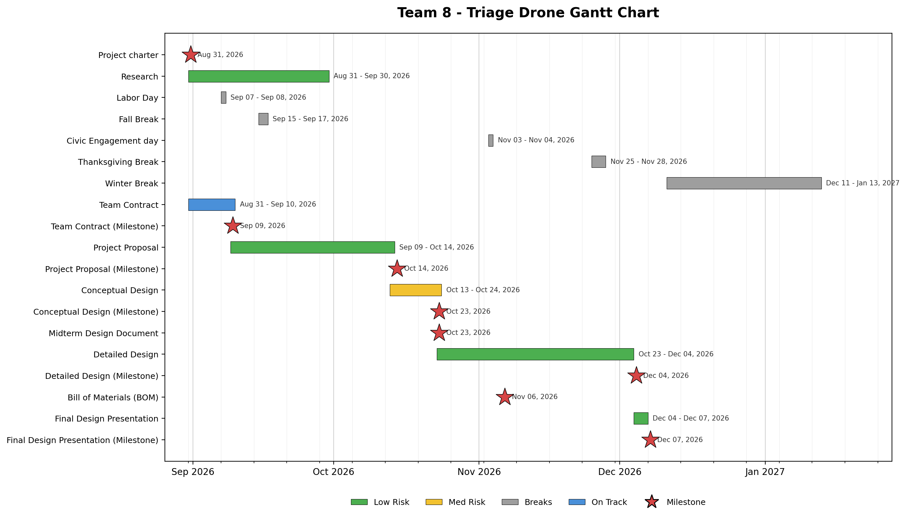

# Project Proposal
**Capstone I – Team 8**  
**Triage Drone**

**Team Members:**  
Ryan Lee  
Allison Wolden  
Weston LaRue  
Brandon Price  
Sidney Delgado  

---

## Table of Contents
- [I. Introduction](#i-introduction)
- [II. Challenges and Obstacles](#ii-challenges-and-obstacles)
- [III. Goals](#iii-goals)
- [IV. Specifications & Measures of Success](#iv-specifications--measures-of-success)
- [V. Constraints](#v-constraints)
- [VI. Survey of Existing Solutions & Relevant Literature](#vi-survey-of-existing-solutions--relevant-literature)
  - [A. Radar](#a-radar)
  - [B. Image Processing](#b-image-processing)
  - [C. Deep Learning for Object Detection](#c-deep-learning-for-object-detection)
  - [D. UAV Path Planning](#d-uav-path-planning)
  - [E. Power & Payload](#e-power--payload)
  - [F. Communications](#f-communications)
- [VII. Timeline & Budget](#vii-timeline--budget)
- [VIII. Personnel](#viii-personnel)
- [IX. Broader Implications, Ethics, and Responsibility as Engineers](#ix-broader-implications-ethics-and-responsibility-as-engineers)
- [X. References](#x-references)
- [XI. Statement of Contributions](#xi-statement-of-contributions)

---

## I. Introduction
Emergency response efforts in hazardous environments often face a critical bottleneck in the rapid response of identifying and triaging casualties without risking additional human life. While aviation drones excel at visual reconnaissance, terrain mapping, and search and rescue surveillance, standard platforms are unable to evaluate physical trauma or autonomously assess casualties and victim priority. Drones with such capabilities would be vital tools in saving the valuable time and resources of responders, saving more lives in the process. While some drones do possess some of the capabilities required to autonomously categorize victims, they lack the ability to triage victims in the same conditions and at the same speed as a human. This obstacle has become a concern of the Defense Advanced Research Projects Agency (DARPA), who has formulated a challenge to address this problem.

In search and rescue operations, this drone system would enable rapid initial canvassing of disaster, relaying casualty locations and health metrics directly to ground and air medical teams to optimize aid and rescue. The following proposal will outline the design constraints, system specifications, and technical framework of this project to meet this objective. Additionally, it will provide a comparative analysis of contemporary technologies and highlight how the proposed design most effectively addresses the problem.

---

## II. Challenges and Obstacles
* **Weight:** Adding necessary peripherals, such as the sensors and arm.
* **Flight Duration & Battery:** Ensuring the added power loads do not excessively reduce flight time.
* **Range:** Reducing the impact of weather, weight, and battery life on flight distance.
* **Pathfinding:** Sensing methods that allow for semi-autonomous flight.
* **Victim Location:** Sensors may need to detect victims who are obscured.
* **GPS Denial:** Some structures may interfere with GPS signals, meaning the drone may need to take alternate paths for optimal performance.
* **Vital Sensing:** Sensors must accurately communicate a victim’s vitals and visual condition.
* **Weather & Environmental Conditions:** Weather, temperature, and ruined infrastructure may affect the operation of the drone and its subsystems.
* **Frequency Interference:** Audible and operational noise can interfere with the drone’s subsystems.
* **Privacy:** Recorded data is sensitive information and must be kept private.

The drone will retain many aspects from the research of previous teams, but our design must focus on the functionality of the external devices in tandem with the drone. This will require more precise filtering, power management, and general controls.

---

## III. Goals 

### Semi-autonomous Flight
* **Objective:** Drone is capable of semi-autonomous flight through GPS waypoint navigation and object detection using Lidar. The drone should be able to generate and follow its own flight paths with little to no human input. 
* **Success Measurement:** The drone is capable of independently navigating a predefined area with predetermined waypoints and avoiding obstacles while maintaining a stable flight with minimal human input.

### Search & Detection Capabilities 
* **Objective:** Integrated sensing and processing methods that allow the drone to detect and locate victims within a 6 ft radius of the drone. Including their heart rate, respiration rate, and facial expression. This will work in obstructed or harsh conditions. 
* **Success Measurement:** The drone will successfully identify victims under partial interference conditions in 80% of the test trials. 

### Voice Based User Interaction
* **Objective:** Implement a two-way communication system to complete a preliminary assessment used to determine a victim's status and identity directly through the drone. Including stating their injuries, stating their name, receiving feedback from the command center, etc.
* **Success Measurement:** The drone will successfully be able to transmit 80% of the communication in an emergency triage situation.

### Environmental Durability
* **Objective:** All modifications and electronic components can sustain exposure to hazardous environment conditions. Including but not limited to smoke, wind, rain, and low visibility conditions. 
* **Success Measurement:** The drone can maintain flight stability and sensor function in a controlled test with moderate wind speed and low visibility. The 3D printed enclosure for the electronics will keep them dry. 

---

## IV. Specifications & Measures of Success
1. The system shall detect and locate potential victims within a 6-foot radius horizontal radius of the point directly below the drone while hovering at 6-8 ft above the ground level. 
   * **Measure of success:** The system shall correctly detect and locate a test subject in at least 80% of trials involving partial visual obstruction or other specified interference.
   * **Verification method:** Test
   * **Stakeholders need:** First responders need to locate victims quickly in debris or low visibility areas  
2.  The system shall attempt to measure heart rate and respiration rate using non-contact sensors at a standoff distance of 1 – 2 m. 
   * **Measure of success:** Heart rate readings shall be within ±5 bpm or ±10% of a reference pulse oximeter or chest-strap ECG, whichever is greater. Respiration rate readings shall be within ±3 breaths per minute of a manual reference count. Each shall meet this tolerance in at least 80% of 20 readings on a subject at rest.
   * **Verification method:** Test
   * **Stakeholders need:** Triage personnel need vital signs to prioritize victims
3. The system shall attempt to identify predefined facial expressions when at least 75% of the victim's face is visible. 
   * **Measure of success:** The system shall correctly classify predefined expressions in at least 80% of labeled test cases under the specified lighting and visibility conditions.
   * **Verification method:** Test
   * **Stakeholders need:** Responders need to assess the victim's level of consciousness and distress.
4. The system shall support two-way audio communication between the victim and the remote command center. 
   * **Measure of success:** The system shall successfully transmit and receive at least 80% of predefined test messages under specified operating conditions.
   * **Verification method:** Test
   * **Stakeholders need:** With arrival of the drone, the audio of the distressed individual must be heard clearly as well as our feedback must be clearly heard by the individual.  
5. The system shall maintain its required functions under specified environmental conditions such as winds, light rain, and low visibility. 
   * **Measure of success:** The system shall complete a controlled test under a defined wind speed and visibility level, remain functional, and pass a defined moisture-6 exposure test.
   * **Verification method:** Test
   * **Stakeholders need:** Disaster response often takes place in poor condition.
6. The drone shall supply sufficient power to the full payload without exceeding the limits of the battery’s rated continuous discharge current. 
   * **Measure of success:** The fully equipped system shall complete a test flight lasting at least the minimum mission duration of 15 minutes with sufficient battery reserve to land safely.
   * **Verification method:** Test
   * **Stakeholders need:** Responders need enough flight time to search for and assess victims.
7. The system shall restrict access to victims’ information and health data to unauthorized users as live reporting will be displayed by the control center where authorized personnel will diagnose and assess the data given on hand.  
   * **Measure of success:** Testing shall verify that unauthorized users cannot access protected data where 100% of the unauthorized access attempts are failed.
   * **Verification method:** Test and Inspection
   * **Stakeholders need:** Victims privacy must be protected as required by health privacy regulations. 
---

## V. Constraints
The design for the Triage Drone must fall within the constraints set by governing bodies such as the FCC, FAA, IEEE, HHS, Ul, IEC, as well as Sponsor and test site requirements. The constraints are as follows: 
* The drone **SHALL** remain under 400 ft above ground level per 14 CFR §107.51.[12][14] This limit shall be enforced in the flight controller firmware.  
* The drone **SHALL** not exceed a ground speed of 87 knots (100 mph) per 14 CFR §107.51 [12][14]. This limit shall be enforced in the flight controller firmware. 
* The drone **SHALL** be equipped with anti-collision lighting visible for at least 3 statute miles for night and civil twilight operations per 14 CFR §107.29 [12][14]. The lighting must be included in the weight and the power budget. 
* The drone **SHALL** weigh under 55 lbs. at takeoff, including payload and batteries, per 14 CFR §107.3 [12][14]. This sets the mass budget for sensors and batteries.  
* The drone **SHALL** remain within the visual line of sight of the remote pilot in command per 14 CFR §107.31 [12]. This limits mission range and supports the human oversight requirement in Constraint 9. 
* The drone **SHALL** comply with Remote ID requirements per 14 CFR Part 89 [24], using built-in Remote ID or a broadcast module included in the weight and power budget. 
* The drone **SHALL** meet the requirements for operations over people per 14 CFR Part 107 Subpart D [25], including having no exposed rotating parts that could lacerate human skin. Propeller guards or ducted fans shall be used, and a minimum hover offset shall be maintained above victims.
* Flight testing in controlled airspace **SHALL** obtain FAA airspace authorization per 14 CFR §107.41 (for example, through LAANC) [12].
* The drone **SHALL** utilize encrypted wireless communication conforming to IEEE 802.11 standards for control and data transmission [18].
* All radio transmitters **SHALL** be FCC-certified devices operating in unlicensed bands within the power limits of 47 CFR Part 15, including §15.247 for 2.4 GHz and 5.8 GHz transmitters [26]. Antennas and transmit power shall not be modified beyond their certified configuration.
* Onboard electronics **SHALL** meet the unintentional radiator emission limits of 47 CFR part 15 Subpart B [26].
* The EMI test setup **SHALL** maintain all measurement tolerances within the limits specified by MIL-STD-461G § 4.3.1 [19].
* Lithium batteries **SHALL** comply with the IEC 62133-2 or UL 2054 safety requirements [27] and SHALL meet UN 38.3 if shipped [35].
* The drone's electrical system **SHALL** be designed following ANSI/UL 3030 for unmanned aircraft systems [29].
* The system’s moisture protection **SHALL** be rated and tested per IEC 60529 [22].
* The system **SHALL** not store health information onboard or associate such data with any identified individual. Vital sign and image data SHALL only be transmitted, encrypted, to the command center and tagged with an anonymous victim ID rather than a name.
  * HIPAA Privacy and Security Rules, 45 CFR Parts 160 and 164 [30], apply when the drone is operated by a covered entity such as an EMS agency.
* The system SHALL operate at an autonomy level functionally equivalent to SAE J3016 Level 3, where the drone can perform mission tasks under limited conditions while maintaining continuous human oversight [20].
* Testing involving human subjects for vital sign and facial expression measurements SHALL be reviewed by the university Institutional Review Board (IRB) or receive a documented exemption before testing begins [31].
* The project SHALL be completed within the sponsor budget of $1,000 and by the final demonstration date of Spring 2027, and all flight testing SHALL follow university flight and test site policies.
* The drone and its UAS critical components (flight controller, communication and data transmission systems, ground control station, navigation system, batteries, and motors) SHALL not be equipment on the FCC Covered List, unless they were previously FCC-authorized or have been exempted through the Department of War Blue UAS Cleared List or an FCC Conditional Approval [27]. All components shall be checked against the Covered List before purchase, and any modification to the drone’s radio or communication hardware shall be reviewed to confirm it does not require a new FCC equipment authorization.
* The drone radar SHALL fit within the 57.0–59.4 GHz sub-band [39].
* The drone radar SHALL stay below the peak power limit of 30 dBm EIRP [39]. 

---

## VI. Survey of Existing Solutions & Relevant Literature

### A. Radar
#### General Overview
Non-contact vital sign monitoring with radar has gained substantial attention due to the availability of both low-cost radar devices and computationally efficient algorithms for processing their measurements. The importance of this measurement for a triage drone will be prioritizing victims during emergency searches based on vital readings. Non-contact measurements are necessary when dealing with emergency reconnaissance and the well-being of the victims.

#### Key Considerations
Radar-based non-contact vital sign monitoring comes with many different considerations for this application:
* Fine-tuning radar signals to avoid interference from drone vibrations or external motion.
* Differentiating between heart rate and breathing rate, both of which fall within the 0.1–3 Hz frequency range.
* Designing for minimal power consumption without sacrificing signal fidelity.
* Implementing onboard processing to reduce latency and improve real-time responsiveness.
* Proper data handling to follow HIPAA regulations and information privacy laws.

#### Example: Autonomous Healthcare and NASA Wireless Heartbeat and Breathing Detection using Radar
At Stevens Institute for Technology, they have done research with Autonomous Healthcare and NASA to research vital sign monitoring with radars and AI. The system includes 3D color camera images and scanning to gain accurate vital sign readings. They use a continuous wave radar that focuses on the beam to get the best possible reading [41]. 

* **Benefits:**
  * This system gathers very accurate vital sign data readings.
  * This research is extremely applicable to the team's project as it covers the main specifications in the project.  
* **Drawbacks:**
  * For our team the Texas Instruments radar would be more expensive than our current solution.
  * Due to our limited power this solution may not work.  

#### Key Takeaways
* A directional radar is best to get the most accurate readings.

### B. Image Processing 
#### General Overview 
The image processing system needs to improve the images captured by the drone. Reliable images are important for helping the search team identify victims during emergency situations. To achieve this, the camera needs to capture clear, high-quality images and video. When weather or lighting conditions affect image quality, image enhancement may be used to improve visibility. The system must also process images promptly so the search team can receive information while emergencies are taking place. The image processing system needs to be compatible with the rest of the components in the system. Weather and other environmental conditions can limit the ability to capture clear images and identify victims accurately. 

#### Key Considerations
* The image processing system must reliably identify people in aerial images.
* The cameras must capture images with sufficient resolution and clarity. 
* Image enhancement may be needed due to low lighting or shadows. 
* Processed images should be compatible with the other components in the system. 
* Environmental restraints such as dust, rain, and physical obstructions can reduce image quality and disrupt image enhancement. 
* Images must be processed quickly enough to provide useful information during search-and-rescue operations.

### C. Deep Learning for Object Detection
#### General Overview
To perform effective search and rescue (SAR) operations without high-bandwidth video surveillance, autonomous systems use onboard deep learning models such as YOLO (You Only Look Once) to identify potential victims that may be obscured by surrounding objects. Incorporating such a model on computing platforms like the Jetson Nano enables precision diagnostic capabilities that are critical for time-sensitive operations [16].

#### Key Considerations
* Managing power and memory constraints when deployed on hardware such as the Jetson Nano.
* Selecting the correct model architecture to balance speed and accuracy.
* Integrating cross-modal sensor data (e.g., camera and radar) to improve detection in low-visibility environments.
* Training models on specialized SAR datasets to improve victim detection under heavy visual clutter.

#### Example: YOLO Architecture on Jetson Nano for Victim Detection
In [16], a lightweight YOLO model deployed on an embedded Jetson module demonstrated real-time human detection in rubble. By coupling a vision module with onboard radars and acoustic arrays, researchers were able to overcome visual noise to reliably improve detection.

* **Benefits:**
  * Real-time detection of small, partially obscured targets with minimal processing latency [16].
  * Autonomous operation independent of ground stations, further decreasing latency.
  * Scalable across diverse environments with specialized datasets.
* **Drawbacks:**
  * Accuracy still drops in fog, smoke, low-light, or similarly cluttered conditions.
  * Deep learning models require extensive SAR training data to lower the rate of false positives.
  * Opaque decision-making present in such learning models can make decisions hard to interpret.

#### Key Takeaways
* Optimize model deployment on the Jetson Nano to maintain operation under thermal and power constraints [6]. 
* Train and fine-tune YOLO using SAR datasets to improve small target recognition in complex environments.
* Establish hierarchical trigger systems to flag candidate coordinates using visual detection, radar, and acoustic verification to improve detection confidence [16].
* Additional model comparisons and sensor fusion strategies will be deferred to future iterations of the system design.

### D. UAV Path Planning
#### General Overview
To achieve autonomous navigation with minimal operator input, SAR drones require robust path-planning architecture that can adapt to dynamic environments [16]. This process comes with an array of possible approaches and challenges that have been reviewed in [17]. For this system to be effective, it must reach potential victims quickly and safely regardless of difficult terrain.

#### Key Considerations
* Path optimization must be balanced with energy consumption to extend operational search time and radius.
* Algorithmic selection is important; while reinforcement learning offers fast local reaction times, hybrid approaches avoid heavy memory footprint and transfer errors [17].
* Visual sensors must be assisted by onboard navigation radar to handle visual degradation.
* Victim detection should trigger an immediate path-override routine that maintains spatial stability [16][17].

#### Example: Hybrid Framework for Electric UAV Emergency Rescue
Tang et al. [17] evaluated contemporary navigation and detection integration strategies tailored specifically for emergency rescue drones with limited carrying capacities, computational performance, and battery life. Their study analyzed how electric UAVs combine visual detection and navigation technologies to reduce path-planning complexity.

* **Benefits:**
  * Smooth trajectory planning minimizes computational load and extends total flight time [17].
  * Hybrid sensor design ensures reliable obstacle avoidance when cameras are blinded by visual clutter.
  * Enables real-time collision avoidance without ground station latency [17].
* **Drawbacks:**
  * Large datasets are required for diverse victim and environment appearance [17].
  * Inconsistent lighting and shading of urban rubble may cause targets to blend into backgrounds or become obscured.
  * Stationary hovering for target verification places a heavy draw on battery life, reducing total search range [17].

#### Key Takeaways
* Battery consumption must be directly factored into path selection algorithms [17].
* Utilize active radar and acoustic sensors to maintain navigation integrity in low-visibility environments [17].
* Incorporate identification and pathfinding techniques that consider environmental lighting and visual angles.
* Additional path-planning models will be deferred to future iterations of the system design.

### E. Power & Payload
#### General Overview
The Aurelia X4 must carry every added component and still complete the mission. That includes the Jetson Nano, radar module, IMX219 cameras, ReSpeaker microphone array, Lidar, GPS, Wi-Fi adapter, mounts, and the extendable arm. The X4 can carry up to 3.3 lbs of payload, and all of these components draw from the same flight battery that powers the motors. Every added gram and every added watt therefore shortens flight time. For this system to be effective, the fully equipped drone must complete at least the 15-minute minimum mission and keep enough battery reserve to land safely.

#### Key Considerations
* The total payload, including the extendable arm and 3D-printed PETG mounts, must stay under the X4’s 3.3 lb limit with margin for wiring and fasteners.
* A power budget must list the draw of each component, including the Jetson Nano, radar, three cameras, microphone array, Lidar, GPS, and Wi-Fi adapter, so total consumption can be estimated before flight testing.
* Jetson Nano is the largest payload load. Choosing between its 5 W and 10 W power modes trades processing speed for flight time.
* Voltage drops during high motor current, such as take-off or wind gusts, must not reset the Jetson Nano or corrupt sensor data.
* Hovering victim assessment draws heavily on the battery, so sensing time must be included in the energy budget.
* Power wiring must be routed and shielded, so motor and converter noise do not interfere with the radar or audio signals.

#### Example: Onboard Computing and Flight Energy in Autonomous Drones
Boroujerdian et al. [40] studied how the onboard computer affects the battery life and flight time of autonomous drones. They ran five mission workloads, including search and rescue, on an NVIDIA Jetson TX2 companion computer. They measured how much power the computer drew compared with the rotors, and how processing speed changed total mission time and energy. 

* **Benefits:**
  * The onboard computer drew less than 5% of total system power, averaging about 10 W against roughly 300–400 W for the rotors. This suggests the Jetson Nano’s own draw is a small part of the overall energy budget.
  * Faster processing cut hover time spent waiting on decisions and let the drone fly faster safely. In the search-and-rescue workload, mission time dropped by up to 67% and energy use by up to 57% [40].
  * Adjusting processing to the environment (lower detail in open areas, higher detail near obstacles) improved battery use by up to 1.8× [40]. 
* **Drawbacks:**
  * The results come from simulation, so real-world factors like voltage drops during take-off and wind gusts were not captured [40].
  * The study did not measure how the added weight of the computer and sensors affects flight time [40]. That is a major concern for a payload close to the X4’s 3.3 lb limit.
  * Noisy sensor data increased mission time by up to 90% and caused mission failures [40]. Shielding power wiring from motor and converter noise is therefore needed to protect the radar and audio signals. 

#### Key Takeaways
* The rotors dominate energy use. Total mission time and payload weight should be the main focus of the power budget, rather than the Jetson Nano’s draw alone.
* The Jetson Nano’s 10 W mode may extend usable flight time, because faster processing shortens hovering during victim assessment, even though it draws more power than the 5 W mode.
* Hover time for sensing and processing must be included in the energy budget [40].
* Bench measurements on the actual X4 are still needed to confirm these simulated results. 

### F. Communications
#### General Overview
Adequate data needs to be transmitted to perform triage properly. This is accomplished through the use of the Jetson nano and multiple sensors to gather the data for a certain victim. The Jetson nano can use Bluetooth, Wifi, Ethernet, Cellular, LoRa (long range, low bandwidth IoT) to transmit data over a variety of distances. To accommodate all the sensors for the team's design, they will need a bandwidth of about 17 Mbps.  

Bluetooth will not work because of the short range and ethernet would only be applicable for bench testing. LoRa has very long range and can easily transmit GPS and vitals' data. LoRa does not have the capability to transmit audio or video. Wifi will work for a shorter range of ~100 meters. A benefit is that it is cheap and has the ability to transmit video and audio.  

#### Key Considerations
* Proper data handling to follow HIPAA regulations and information privacy laws. 
* The communication range is important because of the rugged environments the device will be placed in.  
* Power consumption plays a big role in which the device is most effective while still meeting the requirements set by Dr. Blair.  
* The video feed needs to be clear enough to see facial expressions.  

#### Example: Hybrid Framework for Electric UAV Emergency Rescue
The company Everdrone operates drones used to aid first responders in emergencies in Sweden. They are more agile and faster than EMS services when responding to emergencies such as cardiac arrest. The use of cellular wireless communication is implemented into medical drones to allow for a large range of operation.  

* **Benefits:**
  * Offers lifesaving care to many people. 
  * The range for drones is very wide and typically covers thousands of kilometers.  
* **Drawbacks:**
  * High cost because it is a new technology. 
  * The human to machine relationship needs to be considered when implementing this into a community. People may be less likely to recognize it as "help" when compared to first responders.  

#### Key Takeaways
* Cellular communication is the ideal form of wireless communication because of the long range.
* When the team is designing our solution, it is important for us to take into consideration the human-machine relationship.  

---

## VII. Timeline & Budget

### Gantt Chart

### Bill of Materials (BOM)

| Item | Total Quantity Needed | Purchased Quantity | Predicted Total Cost of Quantity | Justification |
| :--- | :---: | :---: | :---: | :--- |
| **Yahboom IMX219 Camera Module** | 3 | 1 | $30 | Used as a secondary method to identify victims and aid in situational awareness [Spec. X]. Attached at the front and rear of the drone all 360 degrees around the drone will be visible. |
| **ReSpeaker Microphone Array V2.0** | 1 | - | Owned | Provides communication allowing responders to check the victim for awareness [Spec. X]. Can be filtered to the 80-225 Hz band [Spec. X]. Recordings will not be stored to comply with HIPAA regulations regarding two-party consent [Spec. X]. |
| **Lidar Sensor** | 1 | - | Owned | Used for obstacle detection and semi-autonomous flight path planning, ideal for low-visibility conditions [Spec. X]. Solution for pathfinding and degraded sensing challenges to align with UAV path-planning requirements. |
| **PETG 3D Printing Filament ELEGOO** | 2 | 2 | $24 | Used to create custom mounts for all electronic components because it is resistant to moisture and UV. Although ASA would be the better option as it is known for its ability to withstand the sun and heat, it is significantly more expensive than PETG and more hazardous [15]. Will reduce noise caused by vibrations from the drone. Supports robust sensing accuracy while in motion [Specs. X]. It also allows for more streamlined integration of radar and image processing outlined in Section VI. |
| **GPS** | 1 | - | Owned | Used to geotag where the victim is and operator situational awareness. This supports triage reporting and near real-time display [Spec. X and X]. It also contributes to the return-to-home and lost link functions as they both depend on position data [Spec. X]. |
| **Jetson Nano** | 1 | - | Owned | Used to control sensors, cameras, microphone, and speaker. It is a Single-Board Computer (SBC) and is recommended by the drone manufacturer for its processing power, object detection, and speech processing [Spec. X]. |
| **Aurelia X4 Standard Drone** | 1 | - | Owned | Used to transport and house all sensors needed to perform triage on a victim. It comes equipped with the Pixhawk flight controller that includes ArduPilot used to achieve semi-autonomous flight [Spec. X]. This drone is capable of carrying 3.3lbs of payload. Our payload includes all the electronic components and the extendable arm. It has a micro-USB port which will be used for wireless communication between the Jetson Nano and PC [Spec. X]. |
| **Total Cost** | | | **$54** | |

---

## VIII. Personnel
The Triage Drone team is composed of the following five electrical engineering students:  

* **Weston LaRue** has experience in Digital Signal Processing, Microcontroller Programming, Software Coding, Networking, and Circuit Design. With a background in network communications and audio processing, he has experience in live signal processing and data transfer. 
* **Allison Wolden** has experience in Project Management, Technical Documentation, circuit design, programming sensors and servos, and soldering through SAE Aero Design as the president and member of the Avionics and Propulsion team. In this role, she managed the completion of the Golden Eagle 3 aircraft. While on the Avionics and Propulsion team, she was responsible for designing and implementing test stand circuitry to measure current, voltage, thrust, and RPM. She was also responsible for cutting, soldering, and installing motor and servo wires throughout the aircraft.  
* **Brandon Price** has experience in Power Management, Power Distribution, and Budget Management through his position as a Paid Research Assistant at Tennessee Technological University. In this role, he diagnosed a previous design for a low-cost LoRa water-level module reader and optimized the project to automate it year-round. 
* **Ryan Lee** has experience in Circuit Design, Software Programming, Microcontroller Programming, Power Management, and Data Acquisition from his time interning with data acquisition experts at NASA. In this role, he worked closely with a data acquisition team and another intern to build a portable data acquisition system using proprietary NASA software. He was responsible for calibration of various sensors, budgeting, and optimizing the project so that it could run in various types of harsh rocket engine testing environments.
* **Sidney Delgado** has experience in programming, data analysis, and robotics. Through an internship at Nashville Electric Service, she has analyzed network data and installed communication devices. She has also worked on a robotic arm for a school project using servo motors, sensors, and a microcontroller, and has designed and tested digital logic circuits.

### Interdepartmental & Advisor Collaboration
* **Mechanical Engineering Senior Design Team:** Responsible for designing and modeling the extendable arm in SolidWorks, as well as modeling and 3D printing any mounting components.
* **Dr. Dale Blair (Georgia Tech):** Team customer and advisor. Professional background includes radar systems, systems engineering, and target tracking [13]. Provides technical insight throughout the course of the project. 
* **Dr. Christopher (Storm) Johnson (Tennessee Tech):** Faculty advisor and project manager. Oversees and guides assembly, testing, and evaluation of the drone. Meets weekly with the team to discuss progress and design decisions. 

---

## IX. Broader Implications, Ethics, and Responsibility as Engineers
## References: [20]-[25]

### Safety
The general idea of the triage drone is to reduce the risk to human responders on search and rescue related missions. These drones are particularly sent to sites where access is limited or would place the human responder's own life at risk. With technical advantages there are many to consider but with such a technological approach also brings the idea of malfunction and accidents related to such. When and if malfunctions happen, there would be a delay created and potential loss of safety for the responder. Another consideration to be made is the safety of the drone as well. What environments will the drone need to withstand and what are the worst cases the drone may be placed in? How can we protect the external components and the drone?

#### Mitigation Strategies
* Use a low battery fail-safe for returning to home on low battery or lost link, with a battery reserve for safe landing.
* Protect the enclosure so the components and battery are shielded during a crash.
* Define operating limits for wind, rain, and temperature.

### Privacy 
With drone surveillance and recording data, there is concern in relation to drone surveillance and the data recorded along a flight path. Footage being filmed could potentially reveal criminal activity where that footage can be used by legal states. 

#### Mitigation Strategies
* Process data on the Jetson Nano and send only live results to the command PC. Nothing is saved directly to the drone as far as footage. 
* Ensure IEEE 802.11 standards are followed and protect the PC with access control which is enabled in the Jetson Nano.
* Keep personal identifiers (such as names spoken over audio link) separate from vital sign readings on display or logged data.
* Collect only the data the drone needs and use the drone only for rescue, never general surveillance. 
* Test that unauthorized users cannot access the data as required by the specifications.

### Human-Drone Relationship
Issues of trust exist between human responses and mechanical responses. Responders who distrust the drone may ignore useful data. Responders who trust it too much may act on wrong readings. The project's current predicted accuracy is narrowed to roughly 80%. A false "no vital sign" message could cause a living victim to be disregarded. 

Another consideration is facial detection and fairness. Classification accuracy can vary with lighting, skin tone, age, and injuries. There is also the sense of fright presented to victims, which may throw off baseline readings. 

#### Mitigation Strategies
* Keep a human in the loop as the system operates for oversight and verification.
* Test if readings shown are presented with confidence metrics.

### Regulation
Drone regulations are broad and restricted depending on operating environments. The FAA Part 107 rules limit drones to 400 feet AGL, maximum speed of 100 mph, weight under 55 lbs, and anti-collision lighting for night operations. Search and rescue often requires flying beyond visual line of sight at night or over people, which requires an FAA waiver or authorization. Public safety agencies can operate under their own certificates and request expedited emergency approval from the FAA. State laws add further rules, especially regarding surveillance and how law enforcement can use drone data.

#### Mitigation Strategies
* Design to the strictest requirements.
* Plan for real deployments through an agency that already holds the needed authorization.
* Follow all FAA rules for flights and test flights.
* Monitor rule changes as the FAA develops new rules for beyond visual line-of-sight (BVLOS) operations.

### Economic
The triage drone could lower the cost of search and rescue. Helicopter searches are expensive to operate, while a drone costs far less to buy, run, and maintain. Locating and prioritizing victims faster saves search hours and improves survival outcomes.

Negative economic impacts must also be considered. Smaller, rural, or volunteer departments may not afford the drone. Ongoing costs such as replacement batteries, crash repairs, and software updates are easy to underestimate. There is also concern that agencies could use drones to justify cutting human staff.

#### Mitigation Strategies
* Use low-cost, commercial off-the-shelf (COTS) parts and a modular design so damaged parts can be replaced cheaply.
* Document the design so other teams and agencies can build on it.
* Present the drone as a tool that extends responders' capabilities, not a replacement for them.

### Environmental 
LiPo batteries contain materials that harm the environment if sent to landfills, and they pose fire hazards if disposed of improperly. Damaged drones add electronic waste. A drone flying low can disturb wildlife, and a crash leaves debris behind. Conversely, a battery-powered drone produces far fewer emissions than a helicopter or ground vehicle search.

#### Mitigation Strategies
* Store, charge, and recycle LiPo batteries properly, including discharging them to a safe storage level.
* Design for repair so individual parts can be replaced instead of discarding the whole drone.
* Recover crashed hardware and debris whenever it is safe to do so.

### Global and Societal
Technology that locates people and reads their vital signs could be repurposed for surveillance or military targeting instead of rescue. The team cannot fully control how its work is used later, but its design choices can make misuse harder (e.g., not storing data and not linking health readings to identities).

Globally, a low-cost triage drone could help regions where disasters are frequent and rescue resources are limited. Deploying it internationally brings added responsibilities, including respecting local airspace laws, cultural norms, and community consent. Humanitarian drone use is accepted best when local communities are informed and involved.

#### Mitigation Strategies
* State the drone’s intended purpose clearly in all project documents.
* Keep privacy-protecting design choices (such as no stored data) as fixed features rather than optional settings.
* Involve local responders and communities before any deployment outside a test setting.

### Ethical Considerations and Responsibilities as Engineers
As engineers, the team’s first duty is to hold public safety, health, and welfare above all else, as required by the NSPE Code of Ethics and the IEEE Code of Ethics. For this project, that means being honest about the drone's limits, testing it thoroughly, and never overstating its accuracy.

#### Responsibilities
* **Honesty:** Report true sensor accuracy, flight time, and range. Document failed tests and unmet specifications openly.
* **Safe design:** Build power and wiring systems that protect against shorts and overheating. Test fail-safes instead of assuming they work.
* **Privacy:** Store no health data, link no data to individuals, and secure all data links. Respect anyone recorded during testing.
* **Fairness:** Test detection across different people and conditions and report any limitations.
* **Compliance:** Follow FAA rules, campus policies, and the standards outlined in constraints.
* **Competence:** Work within skill sets. Mechanical design belongs to the ME team, while EE provides clear electrical requirements.
* **Speaking up:** Raise safety and ethical concerns, refuse to approve unsafe work, and design against misuse of the drone.

---

## X. References
[1] Aurelia Aerospace, Aurelia X4 User Manual, Rev. 5, 2026. 

[2] Infineon Technologies, BGT60UTR11AIP 60 GHz Radar Sensor, product page. https://www.infineon.com/cms/en/product/sensor/radar-sensors/radar-sensors-for-iot/60ghz-radar/bgt60utr11aip/  

[3] Infineon Technologies, BGT60UTR11AIP Datasheet. https://www.infineon.com/assets/row/public/documents/24/49/infineon-bgt60utr11aip-datasheet-en.pdf  

[4] Infineon Developer Community, FAQs for XENSIV BGT60UTR11AIP Radar Sensor, 2026. https://community.infineon.com/t5/Knowledge-Base-Articles/FAQs-for-XENSIV-BGT60UTR11AIP-radar-sensor/ta-p/1017137 

[5] Seeed Studio, reComputer J1020 v2 (Jetson Nano) product listing.  

[6] NVIDIA, Jetson Nano power modes (5 W and 10 W). 

[7] Texas Instruments, TPS56637 Synchronous Buck Converter Datasheet. 

[8] Fall 2025 Capstone Team 8, project documents (Power and Safety, Sensors, Communication, Drone Operator, Drone to PC Link, Conceptual Design). 

[9] Fall 2024 Capstone Team 5, project repository and parts list. 

[10] Customer meeting notes with Dr. Blair, September 16, 2026. 

[11] Power and Payload Design, Aurelia X4 Triage Drone, Fall 2026, September 20, 2026. 

[12] Federal Aviation Administration. (n.d.). Small Unmanned Aircraft System (sUAS). 

[13] “W. Dale Blair | IEEE AESS,” Ieee-aess.org, Sept. 10, 2026. https://ieee-aess.org/contact/w-dale-blair (accessed Oct. 02, 2026). 

[14] Electronic Code of Federal Regulations, "14 CFR §107.51 Operating limitations for small unmanned aircraft." Available: eCFR. 

[15] MatterHackers, “MatterHackers,” MatterHackers, 2026. https://www.matterhackers.com/articles/the-best-3d-printing-filament-for-outdoor-use (accessed Oct. 03, 2026). 

[16] F. Ciccone and A. Ceruti, “Real-Time Search and Rescue with Drones: A Deep Learning Approach for Small-Object Detection Based on YOLO,” Drones, vol. 9, no. 8, pp. 514–514, July 2025, doi: 10.3390/drones9080514 (accessed Oct. 8, 2026) 

[17] P. Tang, J. Li, and H. Sun, “A Review of Electric UAV Visual Detection and Navigation Technologies for Emergency Rescue Missions,” Sustainability, vol. 16, no. 5, pp. 2105–2105, Mar. 2024, doi: 10.3390/su16052105 (accessed Oct 8, 2026). 

[18] IEEE, IEEE Standard for Information Technology—Telecommunications and Information Exchange Between Systems Local and Metropolitan Area Networks—Specific Requirements—Part 11: Wireless LAN Medium Access Control (MAC) and Physical Layer (PHY) Specifications—Amendment 1: Enhancements for High-Efficiency WLAN, in IEEE Std 802.11ax-2021 (Amendment to IEEE Std 802.11-2020), vol., no., pp. 1–767, May 19, 2021, DOI. 

[19] U.S. Department of Defense, MIL-STD-461G: Requirements for the Control of Electromagnetic Interference Characteristics of Subsystems and Equipment, Washington, D.C., 2015. 

[20] SAE International. (2021). J3016: Taxonomy and Definitions for Terms Related to Driving Automation Systems for On-Road Motor Vehicles. SAE International, Warrendale, PA. 

[21] C. Bradley and A. Chiou, “Examining the Ethical Considerations of Humanitarian Drones,” 2024. https://www.updwg.org/wp-content/uploads/2024/09/bradley-chiou-2024-examining-the-ethical-considerations-of-humanitarian-drones.pdf 

[22] R. Hoek Spaans et al., “Ethical considerations related to drone use for environment and health research: A scoping review protocol,” PLOS ONE, vol. 19, no. 1, e0287270, Jan. 2024, doi: 10.1371/journal.pone.0287270. 

[23] R. Hoek Spaans et al., “Ethical considerations related to drone use for environment and health research: a scoping review,” Royal Society Open Science, vol. 13, no. 2, 251530, 2026. 

[24] National Society of Professional Engineers, NSPE Code of Ethics for Engineers. 

[25] IEEE, IEEE Code of Ethics, IEEE Policies, Section 7.8.\ 

[26] Health Insurance Portability and Accountability Act of 1996, Pub. L. 104-191, Aug. 21, 1996. 

[27] “List of Equipment and Services Covered by Section 2 of the Secure Networks Act,” Federal Communications Commission, Mar. 09, 2021. https://www.fcc.gov/supplychain/coveredlist (accessed Oct. 21, 2026). 

[28] Association for the Advancement of Medical Instrumentation, ANSI/AAMI EC13: Cardiac Monitors, Heart Rate Meters, and Alarms, Arlington, VA. 

[29] International Electrotechnical Commission, IEC 60529: Degrees of Protection Provided by Enclosures (IP Code), Geneva, Switzerland. 

[30] Wi-Fi Alliance, WPA3 Specification, Austin, TX. 

[31] Electronic Code of Federal Regulations, “14 CFR Part 89: Remote Identification of Unmanned Aircraft.” Available: https://www.ecfr.gov/current/title-14/chapter-I/subchapter-F/part-89 

[32] Electronic Code of Federal Regulations, “14 CFR Part 107, Subpart D: Operations Over Human Beings.” Available: https://www.ecfr.gov/current/title-14/chapter-I/subchapter-F/part-107/subpart-D 

[33] Electronic Code of Federal Regulations, “47 CFR Part 15: Radio Frequency Devices.” Available: https://www.ecfr.gov/current/title-47/chapter-I/subchapter-A/part-15 

[34] International Electrotechnical Commission, IEC 62133-2: Secondary Cells and Batteries Containing Alkaline or Other Non-Acid Electrolytes – Safety Requirements – Part 2: Lithium Systems, Geneva, Switzerland; UL, UL 2054: Household and Commercial Batteries, Northbrook, IL. 

[35] United Nations, Manual of Tests and Criteria, Part III, Section 38.3: Lithium Metal and Lithium Ion Batteries, New York and Geneva. 

[36] UL, ANSI/UL 3030: Standard for Unmanned Aircraft Systems, Northbrook, IL. 

[37] Electronic Code of Federal Regulations, “45 CFR Parts 160 and 164: HIPAA Privacy and Security Rules.” Available: https://www.ecfr.gov/current/title-45/subtitle-A/subchapter-C 

[38] Electronic Code of Federal Regulations, “45 CFR Part 46: Protection of Human Subjects.” Available: https://www.ecfr.gov/current/title-45/subtitle-A/subchapter-A/part-46 

[39] Federal Communications Commission, "Amendment of section 15.255 of the commission’s rules for operation of radar systems in the 57-71 GHz band," FCC Report and  Order, FCC 23-35, Jul. 2023. 

[40] B. Boroujerdian, H. Genc, S. Krishnan, W. Cui, A. Faust, and V. J. Reddi, “MAVBench: Micro Aerial Vehicle Benchmarking,” in Proc. 51st Annual IEEE/ACM Int. Symp. Microarchitecture (MICRO), Fukuoka, Japan, 2018, pp. 894–907, doi: 10.1109/MICRO.2018.00077. 

---

## XI. Statement of Contributions
This proposal was worked on as a team through multiple revisions:

* **Introduction:** Ryan Lee
* **Challenges and Obstacles:** Ryan Lee
* **Specifications:** Sidney Delgado
* **Constraints:** Weston LaRue
* **Set Goals:** Allison Wolden
* **Relevant Literature:** Weston LaRue, Sidney Delgado, Ryan Lee, Brandon Price, Allison Wolden
* **Timeline, Resources, and Budget:** Allison Wolden
* **Personnel:** Allison Wolden, Brandon Price, Ryan Lee, Weston LaRue, Sidney Delgado
* **Implications, Ethics, Responsibility as Engineers:** Brandon Price
* **Editing:** Allison Wolden
